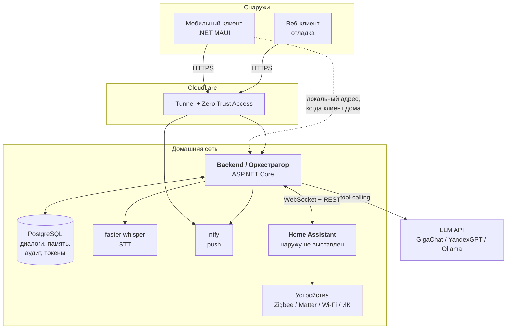

# Домовой

[](https://github.com/k-kuzmin/domovoy/actions/workflows/gitleaks.yml)
[](https://github.com/k-kuzmin/domovoy/actions/workflows/ci-fast.yml)
[](https://github.com/k-kuzmin/domovoy/actions/workflows/ci-heavy.yml)
[](LICENSE)

Персональный AI-агент для умного дома. Управление устройствами и ответы на
вопросы о состоянии дома на естественном языке, через Home Assistant, с
проактивными уведомлениями и собственным набором инструментов.

Отличие от штатных голосовых помощников — полный контроль над системным
промптом, набором инструментов и памятью; данные о доме не уходят третьим
лицам сверх необходимого.

> [!IMPORTANT]
> **В репозитории нет и не должно быть реальных данных.** Ни секретов, ни
> реальных `entity_id`, ни имён хостов, IP, MAC-адресов, ни топика ntfy, ни
> состава жильцов. Все примеры — вымышленная квартира и плейсхолдеры.
> Подробнее: [Секреты и приватные данные](#секреты-и-приватные-данные).

## Статус

<a href="https://github.com/k-kuzmin/domovoy/milestones">
<picture>
<source media="(prefers-color-scheme: dark)" srcset="https://raw.githubusercontent.com/k-kuzmin/domovoy/status/progress-dark.svg">

</picture>
</a>

Дорожная карта — в [milestones](https://github.com/k-kuzmin/domovoy/milestones),
разбивка работ — в [issues](https://github.com/k-kuzmin/domovoy/issues).

Приложение делается пятым, а не первым: промпт и набор инструментов будут
переписываться ежедневно первые недели — на сервере это `git push`, в
приложении пересборка и переустановка.

## Архитектура

Home Assistant не имеет публичного входа. Любой доступ снаружи — только через
Backend, по TLS, через Cloudflare Tunnel: исходящее соединение к edge, входящих
соединений к домашней сети нет, порты на роутере не открываются.



**Разделение ответственности**

| Слой | Отвечает за | Не отвечает за |
|---|---|---|
| Home Assistant | драйверы протоколов, состояния сущностей, детерминированные автоматизации | понимание естественного языка, память диалога |
| Backend | LLM-оркестрация, tool calling, память, профиль дома, проактивные правила, аутентификация | прямое общение с железом |
| Мобильный клиент | UI, запись аудио, приём push, отображение состояния | бизнес-логика, секреты, прямой доступ к HA |

Критичные для безопасности автоматизации — протечка перекрывает воду,
задымление включает сирену — живут на стороне Home Assistant, а не в правилах
Backend: они обязаны срабатывать при остановленном Backend и без интернета.

## Структура решения

```
src/
  Domovoy.Api            HTTP-слой, SSE, аутентификация устройств
  Domovoy.Core           оркестратор, tool-цикл, роутер, шаблоны ответов, порты
  Domovoy.Ha             клиент Home Assistant (REST + WebSocket), реестр сущностей
  Domovoy.Llm            адаптеры провайдеров (GigaChat, YandexGPT, Ollama)
  Domovoy.Voice          STT/TTS
  Domovoy.Notifications  правила проактивности, ntfy
  Domovoy.Data           EF Core, миграции
tests/
  Domovoy.Tests          модульные, архитектурные и smoke-тесты
```

Чистая архитектура, зависимости направлены внутрь. `Domovoy.Core` содержит
только порты и модели и **не ссылается ни на один другой проект решения** —
ни на транспорт, ни на БД, ни на провайдеров. Направление зависимостей
проверяется архитектурным тестом, а не соглашением.

## Стек

| Компонент | Решение |
|---|---|
| Backend | ASP.NET Core 8 (LTS), minimal API |
| Хранилище | PostgreSQL 16 + EF Core |
| LLM основной | GigaChat через OpenAI-совместимый слой |
| LLM резервный | YandexGPT |
| LLM перспектива | локальная модель через Ollama |
| STT | faster-whisper (ru) на сервере |
| TTS | Piper (ru), опционально |
| Push | ntfy, self-hosted |
| Мобильный клиент | .NET MAUI (Android приоритет) |
| Публикация наружу | Cloudflare Tunnel |
| Развёртывание | Docker Compose |

Провайдер LLM задаётся конфигурацией — `base_url`, `api_key`, `model`,
`dialect`. Провайдер-специфичных ветвлений вне слоя адаптера нет.

## Быстрый старт

Нужен только Docker. Запуск на примерах конфигурации, без реальных ключей:
незаполненный секрет — это состояние «не сконфигурировано», а не отказ старта.

```bash
git clone https://github.com/k-kuzmin/domovoy.git
cd domovoy

cp .env.example .env
cp config/entities.example.yaml       config/entities.yaml
cp config/home-profile.example.md     config/home-profile.md
cp config/proactive-rules.example.yaml config/proactive-rules.yaml
cp config/response-templates.example.yaml config/response-templates.yaml

docker compose up -d --build --wait
curl -s http://127.0.0.1:18080/health
```

Ожидаемый ответ — `{"status":"degraded"}`: без токена Home Assistant и ключа
провайдера LLM состояние деградированное, но сервис поднят. Анонимный
`/health` отдаёт только это одно поле; раздельный статус БД, Home Assistant и
LLM доступен на `GET /api/v1/health` под токеном устройства.

Скопированные файлы `config/` и `.env` закрыты `.gitignore` — заполнять их
реальными значениями безопасно. Пароль базы в `.env.example` — значение для
примера: наружу порт базы не публикуется, но при реальной эксплуатации
`POSTGRES_PASSWORD` меняется.

### Стек с Home Assistant

Home Assistant объявлен в том же `docker-compose.yml`, но под профилем `ha`:
обычный `docker compose up` его не поднимает и образ не тянет
([0027](docs/decisions/0027-home-assistant-compose-profile.md)). С профилем HA
встаёт в общую сеть стека, и Backend находит его по имени сервиса из
`HA_BASE_URL`. База живёт в отдельной сети `db` вместе с Backend — HA её не
видит.

```bash
docker compose --profile ha up -d --build --wait
docker compose --profile ha down
```

`--wait` ждёт и healthy Home Assistant: его healthcheck — ответ HTTP-сервера
HA на любой код, от первичной настройки он не зависит
([0029](docs/decisions/0029-home-assistant-healthcheck.md)). HA стартует
дольше Backend: на первом запуске ожидание занимает до нескольких минут.

Чтобы HA поднимался всегда, без ключа, — раскомментировать в `.env` строку
`COMPOSE_PROFILES=ha`. Порт веб-интерфейса на хосте — `HA_HTTP_PORT`
(по умолчанию 8123).

**Первый запуск.** До первичной настройки страница создания владельца HA
открыта любому в локальной сети. Поэтому сразу после первого
`docker compose --profile ha up -d` пройти настройку с самой машины:
`http://127.0.0.1:8123` (или порт из `HA_HTTP_PORT`).

Веб-интерфейс опубликован на все интерфейсы хоста, чтобы открываться с
телефона в домашней сети. Наружу HA не выставляется (NFR-SEC-2): на роутере
под него нет ни проброса порта, ни UPnP-сопоставления, и это проверяется
вручную — с телефона на мобильном интернете страница открываться не должна.

Конфигурация HA — устройства, пользователи, токены — лежит в именованном томе
`homeassistant-config`, вне рабочего дерева. **`docker compose down -v` и
`docker volume prune` удаляют этот том**: HA после них настраивается заново.

## Резервное копирование и восстановление

Сценарии — в [`ops/backup/`](ops/backup/); подробности поведения и
предостережения — в их шапках.

**Что входит.** Каждую ночь в каталоге `domovoy-backup-<UTC-метка>`:

- `db.dump` — база Backend;
- `ha-config.tar.gz` — том конфигурации Home Assistant, снятый без его
  остановки;
- `manifest.txt` — числа для проверки восстановления, без `entity_id`.

**Место и объём** задаются в `.env`: `BACKUP_DIR` — существующий каталог на
внешнем носителе, например `<внешний-диск>/domovoy-backups`;
`BACKUP_MAX_SIZE_GB` — лимит суммарного объёма в ГБ, пусто — без лимита.
Хранятся 14 последних бэкапов. Неподключённый носитель и каталог внутри клона —
отказ, а не запись на системный диск.

**Расписание** — ежедневно в 03:30, задача `domovoy-backup` Планировщика
заданий Windows. Её ставит последним шагом установщик движка
`deploy/windows/engine-setup.ps1 -Install` (раздел «Автозапуск после
перезагрузки»), отдельного шага нет. Задача идёт без входа пользователя (тип
входа S4U, пароль не хранится):

```
wsl.exe -d domovoy-engine --cd <клон> --exec bash ops/backup/backup.sh
```

`backup.sh` выполняется внутри дистрибутива движка, где `docker` — сам
движок: ни интерактивной оболочки, ни обёртки задаче не нужно. `BACKUP_DIR`
задаётся путём Windows вида `D:/domovoy-backups` — внутри дистрибутива его
переводит `wslpath`. Правка `.env` переустановки не требует. Пропущенный
запуск (хост был выключен) Планировщик выполняет при первой возможности;
если dockerd в этот момент ещё поднимается, прогон откажет строкой в
`backup.log`, и следующий пойдёт в срок.

Бэкап вне расписания на хосте с движком в WSL — из каталога клона:
`wsl.exe -d domovoy-engine --exec bash ops/backup/backup.sh`. На Linux с
docker в оболочке — `bash ops/backup/backup.sh`.
Состояние задачи (тип входа, последний результат) и хвост `backup.log`:

```powershell
powershell -ExecutionPolicy Bypass -File ops/backup/install-schedule.ps1 -Check
```

**Бэкап — секрет.** В нём токены Home Assistant, разметка дома, диалоги и
аудит: носитель хранится как ключ от дома и без шифрования в облако не
копируется.

**Проверка восстановления** — последний бэкап из `BACKUP_DIR` поднимается в
отдельном изолированном проекте compose, рабочий стек не трогается:

```bash
bash ops/backup/restore.sh --check
# хост с движком в WSL — из каталога клона:
wsl.exe -d domovoy-engine --exec bash ops/backup/restore.sh --check
```

**Полное восстановление после потери данных** —
`restore.sh --project <имя-проекта-из-.env> --from <каталог-бэкапа>`.
Порядок и предостережения (`down -v`, отказ рядом с работающим HA другого
проекта) — в шапке [`ops/backup/restore.sh`](ops/backup/restore.sh).

## Автозапуск после перезагрузки (Windows, WSL2)

На хосте с Windows 11 стек живёт в Docker Engine внутри своего
WSL2-дистрибутива `domovoy-engine`. Дистрибутив поднимает задача Планировщика при запуске
системы — без входа и без хранимого пароля. Почему так и что отвергнуто —
[0028](docs/decisions/0028-docker-engine-in-wsl.md); сеть движка — NAT и
portproxy вместо mirrored — [0030](docs/decisions/0030-wsl-nat-portproxy.md).
Сценарии — в [`deploy/windows/`](deploy/windows/), подробности — в их
шапках.

**Предусловия** — сценарий их не проверяет:

- в BIOS включено «восстановление после пропадания питания — включиться»
  (Restore on AC Power Loss: Power On);
- BitLocker без PIN до загрузки — иначе загрузка ждёт ввода;
- WSL2 установлен (`wsl --version`), клон лежит на локальном диске;
- адрес хоста в ЛВС закреплён за ним в DHCP роутера (резервирование
  адреса): доступ из ЛВС привязан к этому адресу. Сменился адрес — DHCP или
  другая сеть — повторить `-Install`.

**Что сценарий проверяет сам** — `-Install` отказывает до первого
изменения, `-Check` даёт FAIL:

- сеть хоста — частная (профиль Private в «Параметры → Сеть и Интернет»):
  адрес для доступа из ЛВС берётся только в частной сети, правило
  межсетевого экрана действует только в профиле Private;
- профили межсетевого экрана Windows Domain, Private и Public включены и по
  умолчанию блокируют входящие: доступ из ЛВС привязан к адресу, а не к
  сети, и в общественной сети порты стека закрыты, только пока это так;
- служба IP Helper (`iphlpsvc`) запускается автоматически.

**Сеть и порты** — `API_HTTP_PORT` и `HA_HTTP_PORT` из `.env` (по умолчанию
18080 и 8123). Движок работает в сети WSL NAT (`networkingMode=nat`): с
самого ПК стек открывается и по `http://localhost:<порт>`, и по
`http://127.0.0.1:<порт>` — петлю принимает `wslrelay` WSL. Из ЛВС —
по адресу хоста: постоянная запись `portproxy` (`netsh interface portproxy`)
с этого адреса на `127.0.0.1` того же порта и правило межсетевого экрана
Windows — только для локальной подсети и только в частной сети. На роутере
проброса нет. Адрес хоста `-Install` выбирает сам: адрес в частной сети с
маршрутом по умолчанию и наименьшей метрикой; два таких с равной метрикой
или ни одного — отказ с причиной.

**Установка** — терминал PowerShell от администратора, в каталоге клона.
Повторный запуск ничего не дублирует. Дистрибутив при нём кратко
перезапускается (`wsl --terminate domovoy-engine`), и стек на эти секунды
недоступен; если держалка или дистрибутив работали до запуска, держалка сразу
после регистрации задач запускается снова, и контейнеры поднимаются сами
(`restart: unless-stopped`). Строка `keeper.resume` сухого прогона показывает,
будет ли это сделано:

```powershell
powershell -ExecutionPolicy Bypass -File deploy/windows/engine-setup.ps1 -Install -DryRun  # что будет сделано
powershell -ExecutionPolicy Bypass -File deploy/windows/engine-setup.ps1 -Install
```

`-Install` делает следующее:

1. создаёт дистрибутив из официального образа Ubuntu 24.04 и сверяет его
   SHA256 с `SHA256SUMS` того же сервера. Это проверка целостности загрузки,
   а не подлинности: подпись `SHA256SUMS` не проверяется, и образ,
   подменённый на сервере вместе с суммой, проверку пройдёт;
2. ставит внутрь Docker Engine под systemd;
3. регистрирует задачи `domovoy-engine` (держалка дистрибутива) и
   `domovoy-measure-boot` (замер);
4. пишет `networkingMode=nat` в `%USERPROFILE%\.wslconfig` — прежний
   файл сохраняется рядом как `.wslconfig.domovoy-backup`. mirrored,
   записанный установкой прежней версии, переписывается на nat; чужая
   настройка сети — отказ;
5. снимает правило Hyper-V прежней версии и добавляет правило межсетевого
   экрана Windows — только к слушателю `portproxy`, службе IP Helper;
6. ставит записи `portproxy` с адреса хоста в ЛВС на `127.0.0.1` — свои
   записи прежнего адреса снимаются; служба IP Helper (`iphlpsvc`) должна
   запускаться автоматически;
7. ставит расписание бэкапа.

`wsl --shutdown` установка не выполняет: он гасит все дистрибутивы
пользователя. `networkingMode=nat` применяется после него — его
выполняет владелец (путь нового ПК ниже, шаг 4) — и на уже работающем
хосте после первой установки.

**Новый ПК.** Путь один: установка движка, затем восстановление из
последнего бэкапа. Команды шагов 4–6 — в терминале PowerShell от
администратора, в каталоге клона.

1. Предусловия выше выполнены; установлен Git for Windows (Git Bash).
2. Клон и файлы, которых нет в бэкапе: `git clone`, затем `.env` и
   `config/*` (`entities.yaml`, `home-profile.md`, `proactive-rules.yaml`,
   `response-templates.yaml`) — из своего хранилища: бэкап их не содержит
   (шапка [`ops/backup/restore.sh`](ops/backup/restore.sh)). В `.env` —
   `COMPOSE_PROJECT_NAME` прежнего хоста и `BACKUP_DIR` путём Windows вида
   `D:/domovoy-backups`.
3. Подключить носитель с бэкапами: каталог `BACKUP_DIR` виден в
   Проводнике.
4. Установка движка:

   ```powershell
   powershell -ExecutionPolicy Bypass -File deploy/windows/engine-setup.ps1 -Install -DryRun  # что будет сделано
   powershell -ExecutionPolicy Bypass -File deploy/windows/engine-setup.ps1 -Install
   wsl --shutdown                               # применяет NAT, гасит все дистрибутивы
   Start-ScheduledTask -TaskName domovoy-engine # держалка: дистрибутив и docker поднимаются
   ```

   `restore.sh` не ждёт docker и на только что поднятом дистрибутиве
   отказывает «docker недоступен». Перед шагом 5 дождаться `active`:

   ```powershell
   while ((wsl.exe -d domovoy-engine -u root --exec systemctl is-active docker) -ne 'active') { Start-Sleep -Seconds 5 }
   ```

   Цикл не кончается за пару минут — `-Check` из шага 6 назовёт звено,
   которое не поднялось.

5. Восстановление внутри дистрибутива из последнего бэкапа — каталог
   `domovoy-backup-<UTC-метка>` в `BACKUP_DIR` с самой поздней меткой
   (`.partial` — незаконченный, не годится). `restore.sh` сам поднимает
   стек и ждёт `/health`:

   ```powershell
   wsl.exe -d domovoy-engine -u root --exec bash ops/backup/restore.sh --project <COMPOSE_PROJECT_NAME> --from <BACKUP_DIR>/<domovoy-backup-последний>
   ```

   Путь `--from` — в записи Windows, как `BACKUP_DIR` (`D:/domovoy-backups/…`):
   внутри дистрибутива его переводит `wslpath`.
6. Проверка всех звеньев — `-Check`, код 0:

   ```powershell
   powershell -ExecutionPolicy Bypass -File deploy/windows/engine-setup.ps1 -Check
   ```

7. Функция `docker()` в `~/.bashrc` Git Bash (раздел «docker из Git Bash»
   ниже) — чтобы команды `docker` из этого README шли в движок.

Затем руками:

- проверить, что остальные дистрибутивы и сервисы в WSL работают как
  прежде (`.wslconfig` действует на все, и mirrored у них тоже сменился на
  NAT);
- HA и `/health` с телефона в домашней сети. `-Check` проверяет с хоста
  `/health` на `127.0.0.1`, `[::1]` и адресе в ЛВС, записи `portproxy` и их
  слушателя, но не роутер и не Wi-Fi телефона;
- восстановление после ранней недоступности базы: `docker compose stop
  postgres` (через функцию ниже) — `/health` отдаёт 503; `docker compose
  start postgres` — не позже чем через 60 с снова 200, без перезапуска api.

`-Check` только читает: дистрибутив не запускает и не останавливает. Звенья
внутри остановленного дистрибутива помечаются «не проверено», и код тогда
ненулевой. Адрес хоста в ЛВС `-Check` не печатает.

**Сбой пути к стеку никто не сообщает сам.** Сигналы — `measure-boot.log`
(задача замера пишет его при каждом старте; `result=нет ответа 200` — стек
не ответил) и ручной `-Check` (FAIL «нет ответа» у `/health`, FAIL «запись
portproxy на другом адресе» после смены адреса). Автоматического оповещения
нет — остаточный риск, принятый владельцем
([0030](docs/decisions/0030-wsl-nat-portproxy.md), «Остаточный риск»).

**docker из Git Bash.** Движок живёт внутри дистрибутива, поэтому команды
`docker` из этого README идут через обёртку. Строка в `~/.bashrc`:

```bash
docker() { bash "<клон>/deploy/windows/docker-wsl.sh" "$@"; }
```

Обёртка выполняет `docker` внутри дистрибутива в текущем каталоге: каталог
Windows там виден как `/mnt/<диск>/…`, и относительные пути compose
(`./config`) движок находит. Пределы:

- абсолютные пути Windows в аргументах не переводятся;
- `-it` у `docker exec` зависит от TTY Git Bash;
- функция есть только в интерактивной оболочке, поэтому сценарии
  `ops/backup/*.sh` запускаются внутри дистрибутива
  (`wsl.exe -d domovoy-engine --cd <клон> --exec bash ops/backup/…`, так их
  зовут задача бэкапа и путь нового ПК), а не через неё.

**Логи и хронология загрузки.** Перезагрузка или выключение Windows гасит
ВМ WSL без остановки контейнеров
([0028](docs/decisions/0028-docker-engine-in-wsl.md), «Следствия»). Поэтому
логи контейнеров идут в журнал systemd дистрибутива (драйвер логов docker
`journald`), а журнал хранится на диске и сбрасывается раз в 10 с: после
жёсткого отключения теряются только последние секунды. Настраивает это
провижининг `-Install`, проверяет `-Check` — звенья «журнал systemd на диске,
сброс ≤ 10 с», «docker: драйвер логов journald» и «логи контейнеров проекта в
journald».

Где читать логи. Имя контейнера — из `docker ps` (через функцию `docker()`),
вида `<COMPOSE_PROJECT_NAME>-api-1`:

```bash
docker logs --tail 100 <контейнер>     # Git Bash, через функцию docker(); dockerd читает журнал сам
wsl.exe -d domovoy-engine -u root --exec journalctl CONTAINER_NAME=<контейнер> --since "<ГГГГ-ММ-ДД ЧЧ:ММ:СС>"
wsl.exe -d domovoy-engine -u root --exec journalctl CONTAINER_NAME=<контейнер> -b -1   # предыдущая загрузка ВМ: после выключения хоста это запуск до него; текущая — -b 0 или --since
```

**Разово на хосте, где движок ставился до журнала.** Повторный `-Install`
(раздел «Установка» выше) пишет настройки журнала и драйвера и перезапускает
дистрибутив. Драйвер логов задаётся контейнеру при создании, поэтому
существующие контейнеры стека остаются на прежнем драйвере, пока их не
пересоздать — один раз, тома не трогаются:

```bash
docker compose --profile ha up -d --force-recreate   # Git Bash, в каталоге клона, через функцию docker()
```

До этого `-Check` отдаёт FAIL у звена «логи контейнеров проекта в journald»
и называет контейнеры. На новом ПК пересоздавать нечего: контейнеры создаёт
`restore.sh` уже с журналом.

**Проверочные перезагрузки и замер — хронология загрузки.** Задача
`domovoy-measure-boot` после каждой загрузки пишет хронологию в
`%LOCALAPPDATA%\domovoy-engine\measure-boot.log` пользователя, от
которого идёт держалка (S4U, обычные права — не SYSTEM: сценарий лежит в
клоне). Журнал на стороне Windows: выключение ВМ его не задевает, а строка
пишется в момент события — жёсткое отключение хоста теряет только то, что
ещё не наступило. Каждые 5 с замер опрашивает `/health` и, если дистрибутив
уже работает, зонд внутри него (`deploy/windows/boot-probe.sh`); сам
дистрибутив он не поднимает.

Строка на событие, у каждой — метка загрузки `boot=<старт ОС>`, момент в
местном времени с секундами от старта ОС и источник момента: `src=windows`
(часы Windows) или `src=engine` (изнутри ВМ):

| Событие | Что это |
|---|---|
| `os_start` | старт ОС (Kernel-General 12), рядом `last_boot`, `fw_post_ms` (`FwPOSTTime`), `port` |
| `distro_start` | старт дистрибутива `domovoy-engine` |
| `docker_active` | `docker.service` active |
| `container_start` | старт контейнера проекта, `name=…`; повторный старт в окне замера — с пометкой `restart` |
| `container_healthy` | первый опрос, на котором контейнер healthy (точность 5 с); без healthcheck — `healthcheck=нет` и момент старта |
| `health` | смена статуса `/health`, `status=unhealthy`, `degraded` или `healthy` |
| `probe_error` | зонд не ответил полностью (дистрибутив уже есть, docker ещё нет) — текст ошибки |
| итоговая строка | `first_response`, `first_200`, `foreign`, `stop` (причина конца опроса и его время), `result` |

Опрос кончается, когда `/health` healthy, каждый контейнер проекта работает
и все контейнеры с healthcheck healthy (`stop=ready`), когда статусы 5 минут
не менялись (`stop=stable`), или через 30 минут (`stop=timeout`); рядом —
фактическое время опроса. Итог `result=ok` — только при healthy `/health` и
переходе в healthy каждого контейнера; неработающие контейнеры проекта
названы в итоге — «не работает: <имена>»; без ответа 200 формы стека — «нет
ответа 200», без данных о контейнерах — «нет данных о контейнерах». Засчитывается только ответ формы
стека (`{"status":"healthy"}`, `{"status":"degraded"}`, 503
`{"status":"unhealthy"}`); иной ответ 200 помечается как чужой слушатель.

Хронология одной загрузки — строки с её меткой. Логи контейнеров — по
загрузке ВМ WSL, а не по запуску дистрибутива: за текущую —
`journalctl … -b 0` (или `--since`), за предыдущую, до выключения хоста,
— `-b -1` выше:

```powershell
Select-String -Path "$env:LOCALAPPDATA\domovoy-engine\measure-boot.log" -Pattern '^boot=<старт ОС>;' -Encoding UTF8
```

Проверка — две перезагрузки подряд, между ними в систему не входить и
ничего не запускать:

1. «Перезагрузка» из меню Windows — не «Завершение работы»: при быстром
   запуске это гибридная загрузка, а не перезагрузка.
2. Снять и вернуть питание работающего ПК — он включается сам по настройке
   BIOS. Полное время от подачи питания до ответа засекается по часам с
   секундами и сверяется со строкой замера: `FwPOSTTime` плюс секунды от
   старта ОС до 200.

После каждой — `GET http://<адрес-хоста>:<API_HTTP_PORT>/health` с
телефона в домашней сети, затем вход и `engine-setup.ps1 -Check`. Адрес
хоста в issue не переносится.

**Снос движка** — терминал PowerShell от администратора, в каталоге клона:

```powershell
powershell -ExecutionPolicy Bypass -File deploy/windows/engine-setup.ps1 -Uninstall -DryRun  # что будет сделано
powershell -ExecutionPolicy Bypass -File deploy/windows/engine-setup.ps1 -Uninstall
```

`-Uninstall` останавливает стек внутри движка (`stop`, тома целы), снимает
задачи `domovoy-engine` и `domovoy-measure-boot` и расписание бэкапа
`domovoy-backup` (без движка оно ночью будило бы WSL), гасит дистрибутив,
снимает свои записи `portproxy`, правило межсетевого экрана Windows и
правило Hyper-V прежней версии и возвращает `.wslconfig` из копии или
удаляет его по отметке. Никакого другого движка он не поднимает и никуда не
откатывает. Дистрибутив с томами остаётся: `wsl --unregister
domovoy-engine` уничтожает их — только решением владельца. Возврат
`.wslconfig` применится после `wsl --shutdown`; функцию `docker()` из
`~/.bashrc` убрать руками.

**Откат сети к mirrored** (схема 0028 с правилом Hyper-V) — `-Uninstall`
этой версии, затем `-Install` версии до
[0030](docs/decisions/0030-wsl-nat-portproxy.md): он снова пишет mirrored и
пересоздаёт правило Hyper-V; затем `wsl --shutdown` и задача
`domovoy-engine`. Прямой `-Install` прежней версии поверх nat отказывает.

## Локальная разработка

Проекты собираются под `net8.0`. SDK 9 подходит: целевой пакет `net8.0`
подтягивается из NuGet, нужен установленный рантайм 8.0.

```bash
# Git-хуки: без этой команды pre-commit не работает —
# файлы в .githooks не подключаются к клону сами
git config core.hooksPath .githooks

dotnet restore
dotnet build
dotnet test
dotnet run --project src/Domovoy.Api
```

Ещё два инструмента нужны, если задачу ведёт агент в Claude CLI. Обычной
разработке руками они не нужны.

- **python 3** — на нём работает впрыск правил (`.claude/hooks/rule-injector.*`):
  хук напоминает правило в момент действия. Без python хук пропускает вызов, а
  не отказывает — напоминание не граница, и работа без него не встаёт.
- **`jq`** — его читают `scripts/plan.sh` (проверка и рендер плана),
  `scripts/review-comments.sh` (построчные замечания ревью), `scripts/risk.sh`
  (уровень риска) и `scripts/council.sh` (сводка совета).

Как устроен конвейер работы с агентом — [`docs/pipeline.md`](docs/pipeline.md).

Секреты локально — только через `dotnet user-secrets`, они лежат в профиле
пользователя вне дерева проекта:

```bash
cd src/Domovoy.Api
dotnet user-secrets set "Ha:Token"        "<токен Home Assistant>"
dotnet user-secrets set "Llm:ApiKey"      "<ключ провайдера>"
dotnet user-secrets set "Ntfy:Topic"      "<имя топика>"
dotnet user-secrets list
```

### Команды

| Задача | Команда |
|---|---|
| Сборка | `dotnet build` |
| Тесты | `dotnet test` |
| Запуск API | `dotnet run --project src/Domovoy.Api` |
| Формат и стиль | `dotnet format --verify-no-changes` |
| Миграции: создать | `dotnet ef migrations add <Имя> --project src/Domovoy.Data --startup-project src/Domovoy.Api` |
| Миграции: применить | `dotnet ef database update --project src/Domovoy.Data --startup-project src/Domovoy.Api` |
| Поиск секретов: индекс | `gitleaks git --staged --redact --no-banner` |
| Поиск секретов: история | `gitleaks git --redact --no-banner` |
| Стек целиком | `docker compose up -d --build --wait` |
| Стек с Home Assistant (`--wait` ждёт и healthy HA) | `docker compose --profile ha up -d --build --wait` |
| Остановить стек с Home Assistant | `docker compose --profile ha down` |
| Движок в WSL: проверка автозапуска | `powershell -ExecutionPolicy Bypass -File deploy/windows/engine-setup.ps1 -Check` |
| Движок в WSL: снос (без отката) | `powershell -ExecutionPolicy Bypass -File deploy/windows/engine-setup.ps1 -Uninstall` (администратор) |
| Тесты сценариев движка | `bash deploy/windows/engine-setup.test.sh` |
| Состояние расписания бэкапа | `powershell -ExecutionPolicy Bypass -File ops/backup/install-schedule.ps1 -Check` |
| Бэкап вне расписания | `bash ops/backup/backup.sh`; движок в WSL — `wsl.exe -d domovoy-engine --exec bash ops/backup/backup.sh` |
| Проверка восстановления | `bash ops/backup/restore.sh --check` |
| Тесты бэкапа (нужен docker) | `bash ops/backup/backup.test.sh` |

## API

Базовый префикс `/api/v1`, аутентификация — Bearer-токен устройства.
На этапе каркаса любой запрос к `/api/v1`, кроме `POST /auth/device`,
получает `401`: привязка устройств ещё не реализована, и предъявленный токен
отклоняется. `POST /auth/device` анонимный и отвечает `501`.

| Метод | Путь | Назначение |
|---|---|---|
| `POST` | `/auth/device` | регистрация устройства, обмен кода привязки на токен |
| `POST` | `/chat` | текстовый запрос, ответ потоком SSE |
| `POST` | `/voice` | multipart с аудио, первое событие потока — `recognized` |
| `POST` | `/confirm` | подтверждение чувствительного действия |
| `GET` | `/state` | срез состояния дома для экрана «Дом» |
| `POST` | `/action` | быстрое действие из UI, минуя LLM |
| `GET` | `/notifications` | лента уведомлений |
| `GET` | `/health` | раздельный статус БД, Home Assistant и LLM |

Формат ошибок единый: `{ "error": { "code": "...", "message": "...", "details": ... } }`.

`GET /health` без префикса и без токена отдаёт только пригодность к работе —
для healthcheck контейнера и туннеля. Подробный статус компонентов доступен
на `GET /api/v1/health` под Bearer-токеном: публичный домен индексируется и
сканируется, состав компонентов наружу не отдаётся.

## Секреты и приватные данные

Секретов и приватных данных нет в файлах проекта **ни в одной копии** — ни в
публичной, ни в локальной. Веток «чистая» и «рабочая» не существует. Значения
приходят из источников конфигурации .NET, код читает `IConfiguration` и не
знает происхождения значения.

| Среда | Источник |
|---|---|
| Локальная разработка | `dotnet user-secrets` |
| Продакшен | переменные окружения через `env_file` в Docker Compose |

**Приватное — не только ключи.** Реестр сущностей и профиль дома вместе дают
планировку, состав жильцов, расписание отсутствия и расположение датчиков.
Это чувствительнее токенов. Не попадают в репозиторий:

- реальные `entity_id`, особенно содержащие имена людей
- профиль дома: комнаты, жильцы, распорядок
- имена хостов и поддоменов, локальные IP, MAC-адреса
- **имя топика ntfy** — функционально это пароль: знающий его читает
  уведомления и отправляет свои
- правила проактивности с реальными привязками
- дампы БД, бэкапы Home Assistant, логи

**Два рубежа защиты.** Основной — `gitleaks` в pre-commit хуке: блокирует
коммит до попадания данных в историю. Дублирующий — `gitleaks` в CI на каждый
push и PR, на случай коммита в обход хуков. Помимо стандартных правил
провайдеров закрыты токен Home Assistant, ключи GigaChat и Yandex Cloud,
топик ntfy, приватные IPv4, MAC-адреса и реальные имена хостов. В настройках
репозитория включены secret scanning и push protection.

Репозиторий публичный с первого коммита. Схема «сначала приватно, потом
почистить и открыть» не применяется: перезапись истории не удаляет данные из
форков, кэша хостинга и чужих клонов. Секрет, однажды попавший в коммит,
считается скомпрометированным и подлежит **отзыву**, а не удалению.

## Решения

Решения, расходящиеся с ТЗ или не выводимые из него, записаны в
[`docs/decisions/`](docs/decisions/README.md). Причина простая: через
месяц по коду не отличить принятое решение от недосмотра.

Наиболее заметные: в репозитории только плейсхолдеры вместо реальных
хостов, `/health` разделён на анонимный и защищённый, валидация
конфигурации на старте проверяет форму, а не наличие секретов.

## Лицензия

[MIT](LICENSE)
