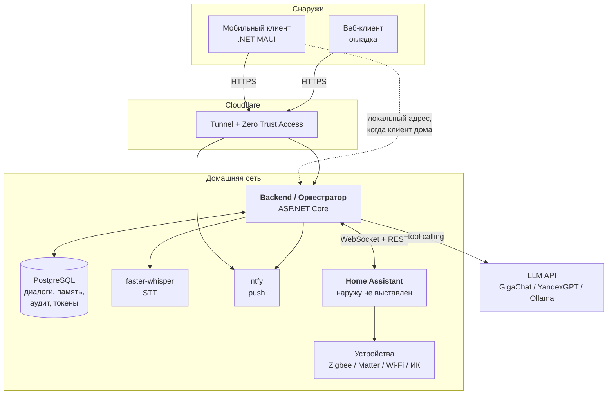

# Домовой

[](https://github.com/k-kuzmin/domovoy/actions/workflows/gitleaks.yml)
[](https://github.com/k-kuzmin/domovoy/actions/workflows/ci-fast.yml)
[](https://github.com/k-kuzmin/domovoy/actions/workflows/ci-heavy.yml)
[](LICENSE)

Персональный AI-агент для умного дома. Управление устройствами и ответы на
вопросы о состоянии дома на естественном языке, через Home Assistant, с
проактивными уведомлениями и собственным набором инструментов.

Отличие от штатных голосовых помощников — полный контроль над системным
промптом, набором инструментов и памятью; данные о доме не уходят третьим
лицам сверх необходимого.

> [!IMPORTANT]
> **В репозитории нет и не должно быть реальных данных.** Ни секретов, ни
> реальных `entity_id`, ни имён хостов, IP, MAC-адресов, ни топика ntfy, ни
> состава жильцов. Все примеры — вымышленная квартира и плейсхолдеры.
> Подробнее: [Секреты и приватные данные](#секреты-и-приватные-данные).

## Статус

<a href="https://github.com/k-kuzmin/domovoy/milestones">
<picture>
<source media="(prefers-color-scheme: dark)" srcset="https://raw.githubusercontent.com/k-kuzmin/domovoy/status/progress-dark.svg">

</picture>
</a>

Дорожная карта — в [milestones](https://github.com/k-kuzmin/domovoy/milestones),
разбивка работ — в [issues](https://github.com/k-kuzmin/domovoy/issues).

Приложение делается пятым, а не первым: промпт и набор инструментов будут
переписываться ежедневно первые недели — на сервере это `git push`, в
приложении пересборка и переустановка.

## Архитектура

Home Assistant не имеет публичного входа. Любой доступ снаружи — только через
Backend, по TLS, через Cloudflare Tunnel: исходящее соединение к edge, входящих
соединений к домашней сети нет, порты на роутере не открываются.



**Разделение ответственности**

| Слой | Отвечает за | Не отвечает за |
|---|---|---|
| Home Assistant | драйверы протоколов, состояния сущностей, детерминированные автоматизации | понимание естественного языка, память диалога |
| Backend | LLM-оркестрация, tool calling, память, профиль дома, проактивные правила, аутентификация | прямое общение с железом |
| Мобильный клиент | UI, запись аудио, приём push, отображение состояния | бизнес-логика, секреты, прямой доступ к HA |

Критичные для безопасности автоматизации — протечка перекрывает воду,
задымление включает сирену — живут на стороне Home Assistant, а не в правилах
Backend: они обязаны срабатывать при остановленном Backend и без интернета.

## Структура решения

```
src/
  Domovoy.Api            HTTP-слой, SSE, аутентификация устройств
  Domovoy.Core           оркестратор, tool-цикл, роутер, шаблоны ответов, порты
  Domovoy.Ha             клиент Home Assistant (REST + WebSocket), реестр сущностей
  Domovoy.Llm            адаптеры провайдеров (GigaChat, YandexGPT, Ollama)
  Domovoy.Voice          STT/TTS
  Domovoy.Notifications  правила проактивности, ntfy
  Domovoy.Data           EF Core, миграции
tests/
  Domovoy.Tests          модульные, архитектурные и smoke-тесты
```

Чистая архитектура, зависимости направлены внутрь. `Domovoy.Core` содержит
только порты и модели и **не ссылается ни на один другой проект решения** —
ни на транспорт, ни на БД, ни на провайдеров. Направление зависимостей
проверяется архитектурным тестом, а не соглашением.

## Стек

| Компонент | Решение |
|---|---|
| Backend | ASP.NET Core 8 (LTS), minimal API |
| Хранилище | PostgreSQL 16 + EF Core |
| LLM основной | GigaChat через OpenAI-совместимый слой |
| LLM резервный | YandexGPT |
| LLM перспектива | локальная модель через Ollama |
| STT | faster-whisper (ru) на сервере |
| TTS | Piper (ru), опционально |
| Push | ntfy, self-hosted |
| Мобильный клиент | .NET MAUI (Android приоритет) |
| Публикация наружу | Cloudflare Tunnel |
| Развёртывание | Docker Compose |

Провайдер LLM задаётся конфигурацией — `base_url`, `api_key`, `model`,
`dialect`. Провайдер-специфичных ветвлений вне слоя адаптера нет.

## Быстрый старт

Нужен только Docker. Запуск на примерах конфигурации, без реальных ключей:
незаполненный секрет — это состояние «не сконфигурировано», а не отказ старта.

```bash
git clone https://github.com/k-kuzmin/domovoy.git
cd domovoy

cp .env.example .env
cp config/entities.example.yaml       config/entities.yaml
cp config/home-profile.example.md     config/home-profile.md
cp config/proactive-rules.example.yaml config/proactive-rules.yaml
cp config/response-templates.example.yaml config/response-templates.yaml

docker compose up -d --build --wait
curl -s http://127.0.0.1:18080/health
```

Ожидаемый ответ — `{"status":"degraded"}`: без токена Home Assistant и ключа
провайдера LLM состояние деградированное, но сервис поднят. Анонимный
`/health` отдаёт только это одно поле; раздельный статус БД, Home Assistant и
LLM доступен на `GET /api/v1/health` под токеном устройства.

**Реестр сущностей обязателен для старта.** `config/entities.yaml` — allow-list
сущностей, доступных агенту; он читается и проверяется при старте
(`ValidateOnStart`). Нет файла, неизвестный домен, действие не из каталога
домена, не заданное обязательное поле, ссылка на несуществующую комнату или
повтор `entity_id` — сервис не стартует, а сообщение называет запись номером
в разделе (`entities[3]`) и поле; значений реестра в нём нет, оно уходит в
лог. Пустой реестр не ошибка: он запрещает всё.

Каталог доменов закрытый: `light`, `media_player`, `vacuum`, `climate`,
`lock`, `sensor`, `binary_sensor`. Сущность любого другого домена — отказ
старта; в том числе `cover`, `switch`, `alarm_control_panel` и `valve` — до
двухфазного подтверждения (#47): сигнализации и вентилю оно обязательно, а
шторы от ворот и розетку от реле ворот или газа по реестру не отличить.
Действия замков
(`lock`, `unlock`) требуют подтверждения всегда, независимо от
`requires_confirmation` в реестре. Реальный реестр проверяется до выката без
подъёма стека — раздел «Живые замеры с Home Assistant (LiveCheck)».

Скопированные файлы `config/` и `.env` закрыты `.gitignore` — заполнять их
реальными значениями безопасно. Пароль базы в `.env.example` — значение для
примера: наружу порт базы не публикуется, но при реальной эксплуатации
`POSTGRES_PASSWORD` меняется.

### Стек с Home Assistant

Home Assistant объявлен в том же `docker-compose.yml`, но под профилем `ha`:
обычный `docker compose up` его не поднимает и образ не тянет
([0027](docs/decisions/0027-home-assistant-compose-profile.md)). С профилем HA
встаёт в общую сеть стека, и Backend находит его по имени сервиса из
`HA_BASE_URL`. База живёт в отдельной сети `db` вместе с Backend — HA её не
видит.

```bash
docker compose --profile ha up -d --build --wait
docker compose --profile ha down
```

`--wait` ждёт и healthy Home Assistant: его healthcheck — ответ HTTP-сервера
HA на любой код, от первичной настройки он не зависит
([0029](docs/decisions/0029-home-assistant-healthcheck.md)). HA стартует
дольше Backend: на первом запуске ожидание занимает до нескольких минут.

Чтобы HA поднимался всегда, без ключа, — раскомментировать в `.env` строку
`COMPOSE_PROFILES=ha`. Порт веб-интерфейса на хосте — `HA_HTTP_PORT`
(по умолчанию 8123).

**Первый запуск.** До первичной настройки страница создания владельца HA
открыта любому в локальной сети. Поэтому сразу после первого
`docker compose --profile ha up -d` пройти настройку с самой машины:
`http://127.0.0.1:8123` (или порт из `HA_HTTP_PORT`).

Веб-интерфейс опубликован на все интерфейсы хоста, чтобы открываться с
телефона в домашней сети. Наружу HA не выставляется (NFR-SEC-2): на роутере
под него нет ни проброса порта, ни UPnP-сопоставления, и это проверяется
вручную — с телефона на мобильном интернете страница открываться не должна.

Конфигурация HA — устройства, пользователи, токены — лежит в именованном томе
`homeassistant-config`, вне рабочего дерева. **`docker compose down -v` и
`docker volume prune` удаляют этот том**: HA после них настраивается заново.

### Схема базы данных

Приложение миграций на старте не применяет. Без миграций `/health`
отвечает, но привязка устройств и админ-эндпоинты получают `503`
`auth_unavailable` — таблиц ещё нет.

**В каталоге развёртывания миграции применяет обновление** (раздел
«Обновление стека» ниже): образ `domovoy-migrate` коммита несёт
идемпотентный SQL-скрипт, и одноразовый сервис `migrate` подаёт его в
`psql` одной транзакцией (`--single-transaction`, `ON_ERROR_STOP`) — после
бэкапа и до перезапуска `api`. Уже применённые миграции скрипт пропускает.
Ни SDK, ни `dotnet-ef` на машине стека не нужны.

**Ручной путь — запасной:** клон разработки (стек из исходников, без
каталога развёртывания) или обновление, которое не прошло. Порт базы наружу
не опубликован, поэтому `dotnet ef database update` с хоста до неё не
дотягивается. Скрипт генерируется на любой машине с SDK .NET 8 и
инструментом `dotnet-ef` 8.x
(`dotnet tool install --global dotnet-ef --version 8.0.*`) из того же коммита,
что развёрнут, и подаётся в `psql` внутри контейнера:

```bash
dotnet ef migrations script --idempotent --output migrate.sql \
  --project src/Domovoy.Data --startup-project src/Domovoy.Api
docker compose exec -T postgres \
  sh -c 'psql -v ON_ERROR_STOP=1 -U "$POSTGRES_USER" -d "$POSTGRES_DB"' < migrate.sql
rm migrate.sql
```

Скрипт пишется в файл, а не в конвейер: в стандартный вывод `dotnet ef`
печатает и строки сборки. Имя пользователя и базы `psql` берёт из окружения
контейнера, `.env` хостовой оболочкой не читается. Для боевого стека
`docker compose exec` идёт в каталоге развёртывания, из Git Bash:

```bash
MSYS_NO_PATHCONV=1 wsl.exe -d domovoy-engine -u root --cd /srv/domovoy --exec docker compose exec -T postgres \
  sh -c 'psql -v ON_ERROR_STOP=1 -U "$POSTGRES_USER" -d "$POSTGRES_DB"' < migrate.sql
```

**Новая миграция.** Создаётся командой из таблицы «Команды» раздела
«Локальная разработка». Сгенерированный основной файл миграции приводится к
стилю проекта до коммита — иначе лишний `using System;` даёт IDE0005, а
предупреждения в сборке — ошибки:

```bash
dotnet format --include src/Domovoy.Data/Migrations/<метка>_<Имя>.cs
```

## Резервное копирование и восстановление

Сценарии — в [`ops/backup/`](ops/backup/); подробности поведения и
предостережения — в их шапках.

**Что входит.** Каждую ночь в каталоге `domovoy-backup-<UTC-метка>`:

- `db.dump` — база Backend;
- `ha-config.tar.gz` — том конфигурации Home Assistant, снятый без его
  остановки;
- `manifest.txt` — числа для проверки восстановления, без `entity_id`.

**Место и объём** задаются в `.env`: `BACKUP_DIR` — существующий каталог на
внешнем носителе, например `<внешний-диск>/domovoy-backups`;
`BACKUP_MAX_SIZE_GB` — лимит суммарного объёма в ГБ, пусто — без лимита.
Хранятся 14 последних бэкапов. Неподключённый носитель и каталог внутри клона —
отказ, а не запись на системный диск.

**Расписание** — ежедневно в 03:30, задача `domovoy-backup` Планировщика
заданий Windows. Её ставит последним шагом установщик движка
`deploy/windows/engine-setup.ps1 -Install` (раздел «Автозапуск после
перезагрузки»), отдельного шага нет. Задача идёт без входа пользователя (тип
входа S4U, пароль не хранится), в каталоге развёртывания:

```
wsl.exe -d domovoy-engine --cd "/srv/domovoy" --exec bash ops/backup/backup.sh
```

`backup.sh` выполняется внутри дистрибутива движка, где `docker` — сам
движок: ни интерактивной оболочки, ни обёртки задаче не нужно. `BACKUP_DIR`
и `BACKUP_MAX_SIZE_GB` он читает из `.env` каталога развёртывания;
`BACKUP_DIR` задаётся путём Windows вида `D:/domovoy-backups` — внутри
дистрибутива его переводит `wslpath`. Правка `.env` переустановки не
требует. Пока каталога развёртывания нет (хост до переноса стека), задача
идёт с `--cd <клон>` и `.env` клона — `-Install` и `-Check` пишут об этом
строкой; после переноса — повторный `engine-setup.ps1 -Install` (раздел
«Перенос стека в каталог развёртывания»). Пропущенный
запуск (хост был выключен) Планировщик выполняет при первой возможности;
если dockerd в этот момент ещё поднимается, прогон откажет строкой в
`backup.log`, и следующий пойдёт в срок.

Бэкап вне расписания на хосте с движком в WSL — в каталоге развёртывания:
`wsl.exe -d domovoy-engine -u root --cd /srv/domovoy --exec bash ops/backup/backup.sh`
(из Git Bash — с `MSYS_NO_PATHCONV=1` впереди, раздел «docker из Git
Bash»). На Linux с docker в оболочке — `bash ops/backup/backup.sh` из
каталога стека.
Состояние задачи (тип входа, последний результат) и хвост `backup.log`:

```powershell
powershell -ExecutionPolicy Bypass -File ops/backup/install-schedule.ps1 -Check
```

**Бэкап — секрет.** В нём токены Home Assistant, разметка дома, диалоги и
аудит: носитель хранится как ключ от дома и без шифрования в облако не
копируется.

**Проверка восстановления** — последний бэкап из `BACKUP_DIR` поднимается в
отдельном изолированном проекте compose, рабочий стек не трогается:

```bash
bash ops/backup/restore.sh --check
# хост с движком в WSL — в каталоге развёртывания (PowerShell):
wsl.exe -d domovoy-engine -u root --cd /srv/domovoy --exec bash ops/backup/restore.sh --check
```

**Полное восстановление после потери данных** —
`restore.sh --project <имя-проекта-из-.env> --from <каталог-бэкапа>`.
Порядок и предостережения (`down -v`, отказ рядом с работающим HA другого
проекта) — в шапке [`ops/backup/restore.sh`](ops/backup/restore.sh).

## Автозапуск после перезагрузки (Windows, WSL2)

На хосте с Windows 11 стек живёт в Docker Engine внутри своего
WSL2-дистрибутива `domovoy-engine`. Дистрибутив поднимает задача Планировщика при запуске
системы — без входа и без хранимого пароля. Почему так и что отвергнуто —
[0028](docs/decisions/0028-docker-engine-in-wsl.md); сеть движка — NAT и
portproxy вместо mirrored — [0030](docs/decisions/0030-wsl-nat-portproxy.md).
Сценарии — в [`deploy/windows/`](deploy/windows/), подробности — в их
шапках.

Стек запускается из **каталога развёртывания** `/srv/domovoy` — отдельного
git-клона в файловой системе дистрибутива, только для запуска; образы `api`
и `migrate` он тянет из GHCR
([0034](docs/decisions/0034-deploy-directory-ghcr-update.md)). Клон Windows
остаётся для разработки и хост-сценариев (`engine-setup.ps1`,
`install-schedule.ps1`, `update.ps1`): их владелец запускает из него, а
настройки стека они читают из `.env` каталога развёртывания. Перенос
работающего стека — раздел «Перенос стека в каталог развёртывания»,
обновление — «Обновление стека».

**Предусловия** — сценарий их не проверяет:

- в BIOS включено «восстановление после пропадания питания — включиться»
  (Restore on AC Power Loss: Power On);
- BitLocker без PIN до загрузки — иначе загрузка ждёт ввода;
- WSL2 установлен (`wsl --version`), клон лежит на локальном диске;
- адрес хоста в ЛВС закреплён за ним в DHCP роутера (резервирование
  адреса): доступ из ЛВС привязан к этому адресу. Сменился адрес — DHCP или
  другая сеть — повторить `-Install`.

**Что сценарий проверяет сам** — `-Install` отказывает до первого
изменения, `-Check` даёт FAIL:

- сеть хоста — частная (профиль Private в «Параметры → Сеть и Интернет»):
  адрес для доступа из ЛВС берётся только в частной сети, правило
  межсетевого экрана действует только в профиле Private;
- профили межсетевого экрана Windows Domain, Private и Public включены и по
  умолчанию блокируют входящие: доступ из ЛВС привязан к адресу, а не к
  сети, и в общественной сети порты стека закрыты, только пока это так;
- служба IP Helper (`iphlpsvc`) запускается автоматически.

**Сеть и порты** — `API_HTTP_PORT` и `HA_HTTP_PORT` из `.env` каталога
развёртывания (по умолчанию 18080 и 8123). Сценарии читают его внутри
дистрибутива через `deploy/envfile.sh get` — только несекретные ключи;
`.env` клона Windows на настройку хоста не влияет. Каталога развёртывания
ещё нет — значения по умолчанию из `docker-compose.yml`, строка
`settings.source` сухого прогона и звено SKIP «настройки каталога
развёртывания» в `-Check` называют причину. Движок работает в сети WSL NAT (`networkingMode=nat`): с
самого ПК стек открывается и по `http://localhost:<порт>`, и по
`http://127.0.0.1:<порт>` — петлю принимает `wslrelay` WSL. Из ЛВС —
по адресу хоста: постоянная запись `portproxy` (`netsh interface portproxy`)
с этого адреса на `127.0.0.1` того же порта и правило межсетевого экрана
Windows — только для локальной подсети и только в частной сети. На роутере
проброса нет. Адрес хоста `-Install` выбирает сам: адрес в частной сети с
маршрутом по умолчанию и наименьшей метрикой; два таких с равной метрикой
или ни одного — отказ с причиной.

**Установка** — терминал PowerShell от администратора, в каталоге клона.
Повторный запуск ничего не дублирует. Дистрибутив при нём кратко
перезапускается (`wsl --terminate domovoy-engine`), и стек на эти секунды
недоступен; если держалка или дистрибутив работали до запуска, держалка сразу
после регистрации задач запускается снова, и контейнеры поднимаются сами
(`restart: unless-stopped`). Строка `keeper.resume` сухого прогона показывает,
будет ли это сделано:

```powershell
powershell -ExecutionPolicy Bypass -File deploy/windows/engine-setup.ps1 -Install -DryRun  # что будет сделано
powershell -ExecutionPolicy Bypass -File deploy/windows/engine-setup.ps1 -Install
```

`-Install` делает следующее:

1. создаёт дистрибутив из официального образа Ubuntu 24.04 и сверяет его
   SHA256 с `SHA256SUMS` того же сервера. Это проверка целостности загрузки,
   а не подлинности: подпись `SHA256SUMS` не проверяется, и образ,
   подменённый на сервере вместе с суммой, проверку пройдёт;
2. делает диск дистрибутива разреженным —
   `wsl --manage domovoy-engine --set-sparse true`: сразу после импорта, а у
   уже зарегистрированного без атрибута `SparseFile` у `ext4.vhdx` — пока
   дистрибутив остановлен на перезапуске провижининга. Флаг `--allow-unsafe`
   сценарий не ставит. Если WSL отказал, `-Install` не обрывается:
   остальные шаги доводятся, в конце — ненулевой код с текстом отказа WSL,
   и звено `-Check` «диск дистрибутива разреженный» красное, пока диск не
   разрежен. Решение за владельцем: `wsl --version`, при остановленном
   дистрибутиве — `wsl --manage domovoy-engine --set-sparse true` вручную
   или повторный `-Install`;
3. ставит внутрь Docker Engine под systemd;
4. регистрирует задачи `domovoy-engine` (держалка дистрибутива) и
   `domovoy-measure-boot` (замер; зонд идёт в каталоге развёртывания);
5. пишет в `%USERPROFILE%\.wslconfig` `networkingMode=nat` и секцию
   `[experimental]`: `sparseVhd=true` (новые диски разреженные) и
   `autoMemoryReclaim=gradual` (ВМ отдаёт хосту освободившуюся память) —
   прежний файл сохраняется рядом как `.wslconfig.domovoy-backup`.
   mirrored, записанный установкой прежней версии, переписывается на nat;
   чужая настройка сети или другое значение `sparseVhd` и
   `autoMemoryReclaim` — отказ;
6. снимает правило Hyper-V прежней версии и добавляет правило межсетевого
   экрана Windows — только к слушателю `portproxy`, службе IP Helper;
7. ставит записи `portproxy` с адреса хоста в ЛВС на `127.0.0.1` — свои
   записи прежнего адреса снимаются; служба IP Helper (`iphlpsvc`) должна
   запускаться автоматически;
8. ставит расписание бэкапа в каталоге развёртывания.

`wsl --shutdown` установка не выполняет: он гасит все дистрибутивы
пользователя. `.wslconfig` (`networkingMode=nat`, `sparseVhd`,
`autoMemoryReclaim`) применяется после него — его выполняет владелец (путь
нового ПК ниже, шаг 4) — и на уже работающем хосте после установки, которая
меняла `.wslconfig`; затем `Start-ScheduledTask -TaskName domovoy-engine`.

**Новый ПК.** Путь один: установка движка, каталог развёртывания,
восстановление из последнего бэкапа, обновление на образы реестра.
Команды — в терминале PowerShell от администратора, в каталоге клона
Windows.

1. Предусловия выше выполнены; установлен Git for Windows (Git Bash).
2. Клон Windows — для хост-сценариев: `git clone`, затем в него `.env` и
   `config/*` (`entities.yaml`, `home-profile.md`, `proactive-rules.yaml`,
   `response-templates.yaml`) из своего хранилища: бэкап их не содержит
   (шапка [`ops/backup/restore.sh`](ops/backup/restore.sh)). Из клона они
   копируются в каталог развёртывания на шаге 5, а `.env` клона нужен и
   шагу 4: пока каталога развёртывания нет, расписание бэкапа берёт
   `BACKUP_DIR` из него и без него не ставится. В `.env` —
   `COMPOSE_PROJECT_NAME` прежнего хоста и `BACKUP_DIR` путём Windows вида
   `D:/domovoy-backups`.
3. Подключить носитель с бэкапами: каталог `BACKUP_DIR` виден в
   Проводнике.
4. Установка движка:

   ```powershell
   powershell -ExecutionPolicy Bypass -File deploy/windows/engine-setup.ps1 -Install -DryRun  # что будет сделано
   powershell -ExecutionPolicy Bypass -File deploy/windows/engine-setup.ps1 -Install
   wsl --shutdown                               # применяет .wslconfig, гасит все дистрибутивы
   Start-ScheduledTask -TaskName domovoy-engine # держалка: дистрибутив и docker поднимаются
   ```

   Каталога развёртывания ещё нет, поэтому порты и проект — по умолчанию,
   а задача бэкапа — с `--cd <клон>`; шаг 8 переводит их на каталог
   развёртывания. `restore.sh` не ждёт docker и на только что поднятом
   дистрибутиве отказывает «docker недоступен». Перед шагом 6 дождаться
   `active`:

   ```powershell
   while ((wsl.exe -d domovoy-engine -u root --exec systemctl is-active docker) -ne 'active') { Start-Sleep -Seconds 5 }
   ```

   Цикл не кончается за пару минут — `-Check` из шага 9 назовёт звено,
   которое не поднялось.

5. Каталог развёртывания — шаги 1 и 2 раздела «Перенос стека в каталог
   развёртывания»: `git clone` в `/srv/domovoy` от root, затем `.env` и
   `config/*` из шага 2 — в него.
6. Восстановление в каталоге развёртывания из последнего бэкапа — каталог
   `domovoy-backup-<UTC-метка>` в `BACKUP_DIR` с самой поздней меткой
   (`.partial` — незаконченный, не годится). `restore.sh` сам поднимает
   стек и ждёт `/health`:

   ```powershell
   wsl.exe -d domovoy-engine -u root --cd /srv/domovoy --exec bash ops/backup/restore.sh --project <COMPOSE_PROJECT_NAME> --from <BACKUP_DIR>/<domovoy-backup-последний>
   ```

   Путь `--from` — в записи Windows, как `BACKUP_DIR` (`D:/domovoy-backups/…`):
   внутри дистрибутива его переводит `wslpath`. Если в `.env` нет ключей
   `COMPOSE_FILE` и `DOMOVOY_IMAGE_*` (их пишет обновление), `restore.sh`
   собирает `api` из исходников каталога развёртывания; если есть — берёт
   образ реестра по тегу из `.env`.
7. Перевод стека на образы реестра головы `main` — обновление (раздел
   «Обновление стека»); локальную сборку `api` из шага 6, если она была,
   оно убирает:

   ```powershell
   powershell -ExecutionPolicy Bypass -File deploy/windows/update.ps1
   ```

8. Повторная установка — настройки хоста, задача бэкапа и зонд замера
   переходят на каталог развёртывания:

   ```powershell
   powershell -ExecutionPolicy Bypass -File deploy/windows/engine-setup.ps1 -Install
   ```

9. Проверка всех звеньев — `-Check`, код 0:

   ```powershell
   powershell -ExecutionPolicy Bypass -File deploy/windows/engine-setup.ps1 -Check
   ```

10. Функция `docker()` в `~/.bashrc` Git Bash (раздел «docker из Git Bash»
    ниже) — для команд `docker` клона разработки. Если на этом ПК идёт
    разработка, в `.env` клона Windows — другое `COMPOSE_PROJECT_NAME`
    (например `domovoy-dev`), иначе стек клона пересоздаст боевые
    контейнеры.

Затем руками:

- проверить, что остальные дистрибутивы и сервисы в WSL работают как
  прежде (`.wslconfig` действует на все, и mirrored у них тоже сменился на
  NAT);
- HA и `/health` с телефона в домашней сети. `-Check` проверяет с хоста
  `/health` на `127.0.0.1`, `[::1]` и адресе в ЛВС, записи `portproxy` и их
  слушателя, но не роутер и не Wi-Fi телефона;
- восстановление после ранней недоступности базы: `docker compose stop
  postgres` в каталоге развёртывания
  (`wsl.exe -d domovoy-engine -u root --cd /srv/domovoy --exec docker compose stop postgres`)
  — `/health` отдаёт 503; `docker compose start postgres` там же — не позже
  чем через 60 с снова 200, без перезапуска api.

`-Check` только читает: дистрибутив не запускает и не останавливает. Звенья
внутри остановленного дистрибутива помечаются «не проверено», и код тогда
ненулевой. Адрес хоста в ЛВС `-Check` не печатает. Звенья диска и
каталога развёртывания: «диск дистрибутива разреженный» (атрибут
`SparseFile` у `ext4.vhdx`), `.wslconfig: sparseVhd=true` и
`.wslconfig: autoMemoryReclaim=gradual` — каждый ключ своим звеном,
«настройки каталога развёртывания» и «стек поднят из каталога
развёртывания» (метка `com.docker.compose.project.working_dir` контейнеров
проекта — FAIL, если стек поднят, например, из клона разработки).

**Сбой пути к стеку никто не сообщает сам.** Сигналы — `measure-boot.log`
(задача замера пишет его при каждом старте; `result=нет ответа 200` — стек
не ответил) и ручной `-Check` (FAIL «нет ответа» у `/health`, FAIL «запись
portproxy на другом адресе» после смены адреса). Автоматического оповещения
нет — остаточный риск, принятый владельцем
([0030](docs/decisions/0030-wsl-nat-portproxy.md), «Остаточный риск»).

**docker из Git Bash.** Движок живёт внутри дистрибутива, поэтому команды
`docker` из этого README идут через обёртку. Строка в `~/.bashrc`:

```bash
docker() { bash "<клон>/deploy/windows/docker-wsl.sh" "$@"; }
```

Обёртка выполняет `docker` внутри дистрибутива в текущем каталоге: каталог
Windows там виден как `/mnt/<диск>/…`, и относительные пути compose
(`./config`) движок находит. Пределы:

- абсолютные пути Windows в аргументах не переводятся;
- `-it` у `docker exec` зависит от TTY Git Bash;
- функция есть только в интерактивной оболочке, поэтому сценарии
  `ops/backup/*.sh` запускаются внутри дистрибутива
  (`wsl.exe -d domovoy-engine --cd /srv/domovoy --exec bash ops/backup/…`,
  так их зовут задача бэкапа и путь нового ПК), а не через неё;
- функция работает в текущем каталоге Windows — то есть с проектом клона
  разработки. Команды по боевому стеку идут в каталоге развёртывания:

  ```bash
  MSYS_NO_PATHCONV=1 wsl.exe -d domovoy-engine -u root --cd /srv/domovoy --exec docker compose ps
  ```

  `MSYS_NO_PATHCONV=1` нужен только в Git Bash: без него `/srv/domovoy`
  превращается в путь Windows раньше, чем его увидит `wsl.exe`. В
  PowerShell та же команда — без него.

**Логи и хронология загрузки.** Перезагрузка или выключение Windows гасит
ВМ WSL без остановки контейнеров
([0028](docs/decisions/0028-docker-engine-in-wsl.md), «Следствия»). Поэтому
логи контейнеров идут в журнал systemd дистрибутива (драйвер логов docker
`journald`), а журнал хранится на диске и сбрасывается раз в 10 с: после
жёсткого отключения теряются только последние секунды. Настраивает это
провижининг `-Install`, проверяет `-Check` — звенья «журнал systemd на диске,
сброс ≤ 10 с», «docker: драйвер логов journald» и «логи контейнеров проекта в
journald».

Где читать логи. Имя контейнера — из `docker ps` (через функцию `docker()`),
вида `<COMPOSE_PROJECT_NAME>-api-1`:

```bash
docker logs --tail 100 <контейнер>     # Git Bash, через функцию docker(); dockerd читает журнал сам
wsl.exe -d domovoy-engine -u root --exec journalctl CONTAINER_NAME=<контейнер> --since "<ГГГГ-ММ-ДД ЧЧ:ММ:СС>"
wsl.exe -d domovoy-engine -u root --exec journalctl CONTAINER_NAME=<контейнер> -b -1   # предыдущая загрузка ВМ: после выключения хоста это запуск до него; текущая — -b 0 или --since
```

**Разово на хосте, где движок ставился до журнала.** Повторный `-Install`
(раздел «Установка» выше) пишет настройки журнала и драйвера и перезапускает
дистрибутив. Драйвер логов задаётся контейнеру при создании, поэтому
существующие контейнеры стека остаются на прежнем драйвере, пока их не
пересоздать — один раз, тома не трогаются:

```powershell
wsl.exe -d domovoy-engine -u root --cd /srv/domovoy --exec docker compose --profile ha up -d --force-recreate
```

До этого `-Check` отдаёт FAIL у звена «логи контейнеров проекта в journald»
и называет контейнеры. На новом ПК пересоздавать нечего: контейнеры создаёт
`restore.sh` уже с журналом.

**Проверочные перезагрузки и замер — хронология загрузки.** Задача
`domovoy-measure-boot` после каждой загрузки пишет хронологию в
`%LOCALAPPDATA%\domovoy-engine\measure-boot.log` пользователя, от
которого идёт держалка (S4U, обычные права — не SYSTEM: сценарий лежит в
клоне). Журнал на стороне Windows: выключение ВМ его не задевает, а строка
пишется в момент события — жёсткое отключение хоста теряет только то, что
ещё не наступило. Каждые 5 с замер опрашивает `/health` и, если дистрибутив
уже работает, зонд внутри него (`deploy/windows/boot-probe.sh`); сам
дистрибутив он не поднимает.

Строка на событие, у каждой — метка загрузки `boot=<старт ОС>`, момент в
местном времени с секундами от старта ОС и источник момента: `src=windows`
(часы Windows) или `src=engine` (изнутри ВМ):

| Событие | Что это |
|---|---|
| `os_start` | старт ОС (Kernel-General 12), рядом `last_boot`, `fw_post_ms` (`FwPOSTTime`), `port` |
| `distro_start` | старт дистрибутива `domovoy-engine` |
| `docker_active` | `docker.service` active |
| `container_start` | старт контейнера проекта, `name=…`; повторный старт в окне замера — с пометкой `restart` |
| `container_healthy` | первый опрос, на котором контейнер healthy (точность 5 с); без healthcheck — `healthcheck=нет` и момент старта |
| `health` | смена статуса `/health`, `status=unhealthy`, `degraded` или `healthy` |
| `probe_error` | зонд не ответил полностью (дистрибутив уже есть, docker ещё нет) — текст ошибки |
| итоговая строка | `first_response`, `first_200`, `foreign`, `stop` (причина конца опроса и его время), `result` |

Опрос кончается, когда `/health` healthy, каждый контейнер проекта работает
и все контейнеры с healthcheck healthy (`stop=ready`), когда статусы 5 минут
не менялись (`stop=stable`), или через 30 минут (`stop=timeout`); рядом —
фактическое время опроса. Итог `result=ok` — только при healthy `/health` и
переходе в healthy каждого контейнера; неработающие контейнеры проекта
названы в итоге — «не работает: <имена>»; без ответа 200 формы стека — «нет
ответа 200», без данных о контейнерах — «нет данных о контейнерах». Засчитывается только ответ формы
стека (`{"status":"healthy"}`, `{"status":"degraded"}`, 503
`{"status":"unhealthy"}`); иной ответ 200 помечается как чужой слушатель.

Хронология одной загрузки — строки с её меткой. Логи контейнеров — по
загрузке ВМ WSL, а не по запуску дистрибутива: за текущую —
`journalctl … -b 0` (или `--since`), за предыдущую, до выключения хоста,
— `-b -1` выше:

```powershell
Select-String -Path "$env:LOCALAPPDATA\domovoy-engine\measure-boot.log" -Pattern '^boot=<старт ОС>;' -Encoding UTF8
```

Проверка — две перезагрузки подряд, между ними в систему не входить и
ничего не запускать:

1. «Перезагрузка» из меню Windows — не «Завершение работы»: при быстром
   запуске это гибридная загрузка, а не перезагрузка.
2. Снять и вернуть питание работающего ПК — он включается сам по настройке
   BIOS. Полное время от подачи питания до ответа засекается по часам с
   секундами и сверяется со строкой замера: `FwPOSTTime` плюс секунды от
   старта ОС до 200.

После каждой — `GET http://<адрес-хоста>:<API_HTTP_PORT>/health` с
телефона в домашней сети, затем вход и `engine-setup.ps1 -Check`. Адрес
хоста в issue не переносится.

**Снос движка** — терминал PowerShell от администратора, в каталоге клона:

```powershell
powershell -ExecutionPolicy Bypass -File deploy/windows/engine-setup.ps1 -Uninstall -DryRun  # что будет сделано
powershell -ExecutionPolicy Bypass -File deploy/windows/engine-setup.ps1 -Uninstall
```

`-Uninstall` останавливает стек внутри движка в каталоге развёртывания
(`stop`, тома целы), снимает задачи `domovoy-engine` и
`domovoy-measure-boot` и расписание бэкапа `domovoy-backup` (без движка
оно ночью будило бы WSL), гасит дистрибутив,
снимает свои записи `portproxy`, правило межсетевого экрана Windows и
правило Hyper-V прежней версии и возвращает `.wslconfig` из копии или
удаляет его по отметке. Никакого другого движка он не поднимает и никуда не
откатывает. Дистрибутив с томами остаётся: `wsl --unregister
domovoy-engine` уничтожает их — только решением владельца. Возврат
`.wslconfig` применится после `wsl --shutdown`; функцию `docker()` из
`~/.bashrc` убрать руками.

**Откат сети к mirrored** (схема 0028 с правилом Hyper-V) — `-Uninstall`
этой версии, затем `-Install` версии до
[0030](docs/decisions/0030-wsl-nat-portproxy.md): он снова пишет mirrored и
пересоздаёт правило Hyper-V; затем `wsl --shutdown` и задача
`domovoy-engine`. Прямой `-Install` прежней версии поверх nat отказывает.

## Каталог развёртывания и обновление (Windows, WSL2)

Боевой стек живёт в `/srv/domovoy` внутри дистрибутива `domovoy-engine`:
это отдельный git-клон только для запуска — в нём не правят и не собирают.
Образы `api` и `migrate` каждого коммита `main` публикует CI в GHCR
(`ghcr.io/<владелец>/domovoy-api` и `ghcr.io/<владелец>/domovoy-migrate`, тег
`sha-<коммит>`); до публикации каждый образ проходит скан секретов. Почему
так и что отвергнуто —
[0034](docs/decisions/0034-deploy-directory-ghcr-update.md).

Команды раздела — в терминале PowerShell от администратора, в каталоге
клона Windows: хост-сценарии запускаются оттуда, а действуют на каталог
развёртывания.

### Перенос стека в каталог развёртывания

Разово — на хосте, где стек уже работает из клона Windows. Тома не
переносятся: имя проекта в каталоге развёртывания то же
(`COMPOSE_PROJECT_NAME` из перенесённого `.env`), и стек подхватывает
прежние тома. Шаги — в этом порядке.

**Перед шагом 3 — видимость пакетов GHCR.** Первая публикация создаёт
пакеты `domovoy-api` и `domovoy-migrate` приватными, а каталог
развёртывания тянет образы без входа в реестр. Разовый шаг владельца после
первой публикации: на GitHub, в настройках каждого из двух пакетов
(Packages → пакет → Package settings → Change visibility) — Public. Пока
пакеты приватные, обновление отказывает до первого изменения: «образа …
нет в реестре».

1. Клон в каталог развёртывания — внутри дистрибутива, от root: тем же
   пользователем `update.ps1` зовёт `update.sh`, и git не отказывает по
   владельцу каталога:

   ```powershell
   wsl.exe -d domovoy-engine -u root --exec git clone https://github.com/<владелец>/domovoy.git /srv/domovoy
   ```

2. Копия `.env` и `config/` из клона Windows — только файлы владельца:
   `.env`, четыре файла `config/` и `docker-compose.override.yml`, если он
   есть. Каталог `config/` целиком не копируется: примеры в нём
   отслеживаются git, и их копия другой версии сделала бы рабочее дерево
   каталога развёртывания грязным — обновление на нём отказывает.

   ```powershell
   wsl.exe -d domovoy-engine -u root --cd "<клон>" --exec install -m 600 .env /srv/domovoy/.env
   wsl.exe -d domovoy-engine -u root --cd "<клон>" --exec cp config/entities.yaml config/home-profile.md config/proactive-rules.yaml config/response-templates.yaml /srv/domovoy/config/
   ```

   `.env` с секретами получает права `600` сразу при копировании: его
   читает только compose от root. Файлам `config/` секретов не положено, и
   `600` им нельзя: `api` читает их через монтирование `./config` от
   непривилегированного пользователя контейнера.

   `COMPOSE_PROJECT_NAME` в `.env` каталога развёртывания — то же, что у
   работающего стека (`domovoy`). `BACKUP_DIR` остаётся путём Windows вида
   `D:/domovoy-backups`.
3. Первое обновление из каталога развёртывания — с `-Adopt`: стек ещё
   поднят из клона Windows, и без него обновление отказывает. Нужны
   запущенные `postgres` и `homeassistant`, доступный `BACKUP_DIR` и
   опубликованные образы. Сначала сухой прогон:

   ```powershell
   powershell -ExecutionPolicy Bypass -File deploy/windows/update.ps1 -Adopt -DryRun
   powershell -ExecutionPolicy Bypass -File deploy/windows/update.ps1 -Adopt
   ```

   Обновление снимает бэкап, применяет миграции и пересоздаёт все
   контейнеры стека — `postgres`, `homeassistant` и `api` — из каталога
   развёртывания, `api` на образе реестра (с `-Adopt` — принудительно,
   `up --force-recreate`: иначе compose пересоздал бы только `api`).
   Данные в именованных томах сохраняются. Следующие обновления идут без
   `-Adopt`. Код 5 на этом шаге
   ожидаем: задача замера и `.wslconfig` ещё по-старому — их переводит
   шаг 4.
4. Повторная установка — задача бэкапа (`--cd "/srv/domovoy"`), задача
   замера, порты firewall и portproxy переходят на каталог развёртывания,
   диск дистрибутива становится разреженным, в `.wslconfig` появляется
   `[experimental]`:

   ```powershell
   powershell -ExecutionPolicy Bypass -File deploy/windows/engine-setup.ps1 -Install
   wsl --shutdown                               # если -Install менял .wslconfig: применяет его, гасит все дистрибутивы
   Start-ScheduledTask -TaskName domovoy-engine
   powershell -ExecutionPolicy Bypass -File deploy/windows/engine-setup.ps1 -Check
   powershell -ExecutionPolicy Bypass -File ops/backup/install-schedule.ps1 -Check
   ```

   В `-Check` звено «стек поднят из каталога развёртывания» — OK; задача
   бэкапа — с `--cd "/srv/domovoy"`.
5. **Только после шага 4** — в `.env` клона Windows другое имя проекта,
   например `COMPOSE_PROJECT_NAME=domovoy-dev`. Тогда `docker compose` в
   клоне разработки поднимает свой стек и не пересоздаёт боевые контейнеры.
   Раньше нельзя: до шага 4 ночная задача бэкапа идёт с `--cd <клон>`,
   искала бы проект `domovoy-dev` и отказала.

`.env` и `config/` в клоне Windows после переноса на боевой стек не
влияют; удалять их или нет — решение владельца.

### Обновление стека

Одна команда — переводит каталог развёртывания на голову `main`:

```powershell
powershell -ExecutionPolicy Bypass -File deploy/windows/update.ps1 -DryRun   # план, ничего не меняет
powershell -ExecutionPolicy Bypass -File deploy/windows/update.ps1
```

`-DryRun` печатает целевой коммит, образы, команду бэкапа, какие ключи
`.env` будут дописаны и какие образы удалены — и не меняет ни каталог, ни
`.env`, ни контейнеры, ни образы. `-Ref <коммит>` — другой целевой коммит
(40 шестнадцатеричных символов).

Обёртка `update.ps1` проверяет, что дистрибутив зарегистрирован и
работает (остановленный она не поднимает — раздел «Автозапуск после
перезагрузки») и что каталог развёртывания на месте, затем зовёт внутри
дистрибутива `deploy/update.sh`. Он:

1. проверяет до первого изменения: движок, compose, чистое рабочее дерево,
   `.env`, запущенные `postgres` и `homeassistant` из этого каталога,
   целевой коммит, наличие обоих образов в реестре, `BACKUP_DIR`;
   параллельный запуск отбивает блокировка;
2. снимает бэкап `ops/backup/backup.sh` и печатает его путь строкой
   `update: бэкап: <путь>`;
3. переключает каталог на целевой коммит;
4. досинхронизирует `.env` по `.env.example`: новый ключ без разметки
   дописывается значением примера, генерируемый секрет — случайным
   значением, ключ от владельца называется строкой
   `.env: заполните <KEY>` — его вписать в `/srv/domovoy/.env` руками
   (`wsl.exe -d domovoy-engine -u root --exec nano /srv/domovoy/.env`), и
   стек получит значение при следующем
   `docker compose --profile ha up -d --wait` в каталоге развёртывания.
   Значения в вывод не попадают;
5. пишет в `.env` тег образа коммита, тянет образы `api` и `migrate`;
6. применяет миграции — сервис `migrate`, одной транзакцией `psql`;
7. перезапускает стек (`up -d --wait`) и проверяет `/health` на
   `127.0.0.1:<API_HTTP_PORT>`;
8. чистит: из образов `domovoy-api` и `domovoy-migrate` остаются текущий и
   предыдущий, кэш сборки движка удаляется (`docker builder prune --all` —
   следующая сборка в клоне разработки пойдёт без кэша).

После успеха обёртка запускает `engine-setup.ps1 -Check`.

| Код | Что значит |
|---|---|
| 0 | обновлено (или сухой прогон) |
| 1 | отказ до первого изменения — причина в строке `отказ:`; стек не тронут |
| 2 | ошибка вызова |
| 3 | провал после изменения, откат выполнен: стек на прежнем коммите и образе отвечает |
| 4 | провал и отказ отката — нужен человек; путь бэкапа в выводе |
| 5 | обновлено, но `engine-setup.ps1 -Check` красный — звенья в его выводе |

**Откат.** Провал после первого изменения — `checkout`, `.env`, pull,
миграция, `up --wait` или `/health` — возвращает прежний коммит, прежние
ключи образа в `.env` и прежний образ и проверяет `/health` (код 3).
**Схема базы не откатывается:** прежний код работает на новой схеме,
пока миграции следуют expand/contract. Красный `-Check` после обновления
образ не откатывает — его звенья (firewall, portproxy, задачи,
`.wslconfig`) от образа не зависят: код 5, стек остаётся обновлённым.

**Прерванное обновление.** Состояние отката лежит файлом
`/srv/domovoy/.git/domovoy-update.state` с начала изменений до конца.
Оборвался процесс — закрыто окно, `wsl --shutdown`, перезагрузка, — файл
остаётся, и следующий запуск `update.ps1` сначала доводит откат по нему
(код 3 или 4), а не начинает новое обновление; `-DryRun` о нём сообщает.
После кода 4 файл тоже остаётся: следующий запуск повторит откат.

Обновление не запускать в окне ночного бэкапа (03:30): общей блокировки с
бэкапом нет.

**Ручные шаги — запасной путь:** обновление отказывает по причине, которую
не снять сразу, или нужен человек после кода 4. Всё — в каталоге
развёртывания, в PowerShell (из Git Bash — с `MSYS_NO_PATHCONV=1`
впереди). После кода 4 файл состояния `.git/domovoy-update.state` ещё
лежит: следующий `update.ps1` сначала вернёт каталог к прежнему коммиту из
этого файла, даже если стек доведён руками до нового, — и только
следующий за ним запуск обновит снова.

```powershell
wsl.exe -d domovoy-engine -u root --cd /srv/domovoy --exec bash ops/backup/backup.sh
wsl.exe -d domovoy-engine -u root --cd /srv/domovoy --exec git fetch origin
wsl.exe -d domovoy-engine -u root --cd /srv/domovoy --exec git checkout --detach <коммит>
wsl.exe -d domovoy-engine -u root --cd /srv/domovoy --exec bash deploy/envfile.sh sync .env.example .env
wsl.exe -d domovoy-engine -u root --cd /srv/domovoy --exec bash deploy/envfile.sh set .env DOMOVOY_IMAGE_TAG sha-<коммит>
wsl.exe -d domovoy-engine -u root --cd /srv/domovoy --exec docker compose --profile migrate pull api migrate
wsl.exe -d domovoy-engine -u root --cd /srv/domovoy --exec docker compose --profile migrate run --rm migrate
wsl.exe -d domovoy-engine -u root --cd /srv/domovoy --exec docker compose --profile ha up -d --wait
curl.exe -s http://127.0.0.1:<API_HTTP_PORT>/health
```

Реестр недоступен — образ `api` собирается на месте, без надстройки
каталога развёртывания (`-f docker-compose.yml`, и
`-f docker-compose.override.yml`, если он есть), а миграции применяются
ручным путём раздела «Схема базы данных»:

```powershell
wsl.exe -d domovoy-engine -u root --cd /srv/domovoy --exec docker compose -f docker-compose.yml --profile ha up -d --build --wait
```

Следующее обновление одной командой возвращает стек на образы реестра.

## Локальная разработка

Проекты собираются под `net8.0`. SDK 9 подходит: целевой пакет `net8.0`
подтягивается из NuGet, нужен установленный рантайм 8.0.

```bash
# Git-хуки: без этой команды pre-commit не работает —
# файлы в .githooks не подключаются к клону сами
git config core.hooksPath .githooks

dotnet restore
dotnet build
dotnet test
dotnet run --project src/Domovoy.Api
```

`dotnet run` считает относительные пути от каталога проекта
`src/Domovoy.Api`, а реестр сущностей проверяется на старте. Путь к нему
задаёт профиль запуска `http` (`Properties/launchSettings.json`):
`../../config/entities.yaml`, копия `config/entities.example.yaml` (см.
«Быстрый старт»). Запуск без профиля (`--no-launch-profile`) требует
`Ha__EntityRegistryPath` явно — переменной окружения или абсолютным путём.

Ещё два инструмента нужны, если задачу ведёт агент в Claude CLI. Обычной
разработке руками они не нужны.

- **python 3** — на нём работает впрыск правил (`.claude/hooks/rule-injector.*`):
  хук напоминает правило в момент действия. Без python хук пропускает вызов, а
  не отказывает — напоминание не граница, и работа без него не встаёт.
- **`jq`** — его читают `scripts/plan.sh` (проверка и рендер плана),
  `scripts/review-comments.sh` (построчные замечания ревью), `scripts/risk.sh`
  (уровень риска) и `scripts/council.sh` (сводка совета).

Как устроен конвейер работы с агентом — [`docs/pipeline.md`](docs/pipeline.md).

Секреты локально — только через `dotnet user-secrets`, они лежат в профиле
пользователя вне дерева проекта:

```bash
cd src/Domovoy.Api
dotnet user-secrets set "Auth:AdminToken" "<админ-секрет не короче 32 символов>"
dotnet user-secrets set "Ha:Token"        "<токен Home Assistant>"
dotnet user-secrets set "Llm:ApiKey"      "<ключ провайдера>"
dotnet user-secrets set "Ntfy:Topic"      "<имя топика>"
dotnet user-secrets list
```

### Живые замеры с Home Assistant (LiveCheck)

`tests/Domovoy.Tests.LiveCheck` — консольная программа для замеров против
настоящего Home Assistant: `dotnet test` её не запускает, сборка решения
собирает. Воркер, кэш и быстрый путь она поднимает той же регистрацией, что
api. Конфигурация — user-secrets api (`dotnet user-secrets` в
`src/Domovoy.Api`) и переменные окружения поверх них. Токен, заданный в
user-secrets для `dotnet run`, LiveCheck берёт оттуда же — выставлять его в
окружение не нужно:

```bash
export Ha__BaseUrl=http://homeassistant:8123        # адрес HA в локальной сети
export Ha__EntityRegistryPath=config/entities.yaml   # от текущего каталога

# p50, p95 и max быстрого пути отдельно для чтения и действий.
# Фразы — по одной в строке, файл держать вне репозитория.
# Без --allow-actions изменяющие фразы пропускаются: устройства не трогаются.
dotnet run -c Release --project tests/Domovoy.Tests.LiveCheck -- \
  latency --phrases ~/domovoy-phrases.txt --iterations 50

# Переходы статуса WebSocket и доступности REST с отметкой времени; после
# каждого Connected — интервал «REST ответил → Connected», время ответа
# get_states и число расхождений кэша с GET api/states. Остановка — Ctrl+C.
dotnet run -c Release --project tests/Domovoy.Tests.LiveCheck -- reconnect
```

Вывод можно прикладывать к issue: токена, адреса Home Assistant и `entity_id`
в нём нет — только статусы, числа и время. Время ответа `get_states`
измеряется после Connected, на уже прогретом HA, — это оценка снизу;
основной показатель восстановления — интервал «REST ответил → Connected».
Время восстановления развёрнутого api видно по переходам
`components.ha_websocket` в `GET /api/v1/health`.

**Проверка реального реестра до выката.** Оба режима сначала проверяют
конфигурацию и реестр — той же проверкой, что старт api, — и только потом
смотрят на токен; соединение с HA для этого не нужно:

```bash
unset Ha__Token
export Ha__BaseUrl=http://homeassistant:8123
export Ha__EntityRegistryPath=config/entities.yaml
dotnet run -c Release --project tests/Domovoy.Tests.LiveCheck -- reconnect
```

Строка «конфигурация и реестр сущностей прошли проверку» — реестр годен.
Если токена нет ни в окружении, ни в user-secrets, следом программа выходит с
«Ha__Token не задан»; иначе продолжает выбранный режим. Отказ печатается типом опций
и числом ошибок, без текста; какие записи (по номеру) и какие поля не
прошли, называет старт api на том же файле — `dotnet run --project
src/Domovoy.Api`: профиль запуска указывает на `config/entities.yaml`.

### Команды

| Задача | Команда |
|---|---|
| Сборка | `dotnet build` |
| Тесты | `dotnet test` |
| Запуск API | `dotnet run --project src/Domovoy.Api` |
| Замер p95 быстрого пути на живом HA | `dotnet run -c Release --project tests/Domovoy.Tests.LiveCheck -- latency --phrases <файл>` |
| Наблюдение за реконнектом к живому HA | `dotnet run -c Release --project tests/Domovoy.Tests.LiveCheck -- reconnect` |
| Формат и стиль | `dotnet format --verify-no-changes` |
| Миграции: создать | `dotnet ef migrations add <Имя> --project src/Domovoy.Data --startup-project src/Domovoy.Api` |
| Миграции: привести новую к стилю | `dotnet format --include src/Domovoy.Data/Migrations/<метка>_<Имя>.cs` |
| Миграции: применить к локальной базе | `dotnet ef database update --project src/Domovoy.Data --startup-project src/Domovoy.Api` |
| Миграции: применить к базе стека | раздел «Схема базы данных» |
| Поиск секретов: индекс | `gitleaks git --staged --redact --no-banner` |
| Поиск секретов: история | `gitleaks git --redact --no-banner` |
| Стек целиком | `docker compose up -d --build --wait` |
| Стек с Home Assistant (`--wait` ждёт и healthy HA) | `docker compose --profile ha up -d --build --wait` |
| Остановить стек с Home Assistant | `docker compose --profile ha down` |
| Движок в WSL: проверка автозапуска | `powershell -ExecutionPolicy Bypass -File deploy/windows/engine-setup.ps1 -Check` |
| Движок в WSL: снос (без отката) | `powershell -ExecutionPolicy Bypass -File deploy/windows/engine-setup.ps1 -Uninstall` (администратор) |
| Тесты сценариев движка | `bash deploy/windows/engine-setup.test.sh` |
| Состояние расписания бэкапа | `powershell -ExecutionPolicy Bypass -File ops/backup/install-schedule.ps1 -Check` |
| Бэкап вне расписания | `bash ops/backup/backup.sh`; движок в WSL — `wsl.exe -d domovoy-engine --exec bash ops/backup/backup.sh` |
| Проверка восстановления | `bash ops/backup/restore.sh --check` |
| Тесты бэкапа (нужен docker) | `bash ops/backup/backup.test.sh` |

## API

Базовый префикс `/api/v1`, аутентификация — Bearer-токен устройства:
`Authorization: Bearer <token>`. Токен устройство получает один раз, при
привязке, обменом одноразового кода — подраздел «Привязка устройства». Любой
маршрут `/api/v1`, кроме `POST /auth/device`, без действующего токена
отвечает `401`; отозванный токен отклоняется со следующего же запроса.
Эндпоинты, чей этап не наступил, при действующем токене отвечают `501`.

| Метод | Путь | Назначение |
|---|---|---|
| `POST` | `/auth/device` | обмен кода привязки на токен устройства, без токена |
| `POST` | `/chat` | текстовый запрос, ответ потоком SSE |
| `POST` | `/voice` | multipart с аудио, первое событие потока — `recognized` |
| `POST` | `/confirm` | подтверждение чувствительного действия |
| `GET` | `/state` | срез состояния дома для экрана «Дом» |
| `POST` | `/action` | быстрое действие из UI, минуя LLM |
| `GET` | `/notifications` | лента уведомлений |
| `GET` | `/health` | раздельный статус БД, Home Assistant и LLM |

Формат ошибок единый: `{ "error": { "code": "...", "message": "...", "details": ... } }`.
Хранилище устройств недоступно — `503` с кодом `auth_unavailable`, а не `401`:
клиент не должен считать токен отозванным из-за сбоя базы.

В базе хранится SHA-256 токена и кода привязки, а не их значения; в логи они
не попадают. Открытое значение токена отдаётся ровно один раз — в ответе
`POST /auth/device`.

### Админ-эндпоинты

Выпуск кода привязки, список устройств и отзыв — под `/api/v1/admin`, со
своей Bearer-схемой: общий секрет `Auth:AdminToken`
([0033](docs/decisions/0033-admin-endpoints-shared-secret.md)). Токен
устройства админку не открывает, админ-секрет не делает запрос устройством.

| Метод | Путь | Ответ |
|---|---|---|
| `POST` | `/api/v1/admin/pairing-codes` | `201`, `{ "code": "...", "expires_at": "..." }` — одноразовый код привязки |
| `GET` | `/api/v1/admin/devices` | `200`, `{ "devices": [ { "id", "name", "created_at", "last_seen_at", "revoked_at" } ] }` |
| `DELETE` | `/api/v1/admin/devices/{id}` | `204`; неизвестное или уже отозванное устройство — `404` `device_not_found` |

`Auth:AdminToken` — случайная строка не короче 32 символов
(`openssl rand -base64 32`). Пусто или плейсхолдер — админ-эндпоинты
закрыты и отвечают `401` на любой запрос; задан, но короче 32 символов — api
не стартует. Значение задаётся только на целевой машине: в `.env` —
`AUTH_ADMIN_TOKEN`, локально — `dotnet user-secrets`. `last_seen_at`
обновляется не чаще раза в минуту. Отзыв пишется в аудит (`audit_entries`,
`revoke_device` с `device_id`), значения токена в записи нет.

### Привязка устройства

1. Владелец выпускает код — он живёт `Auth:PairingCodeLifetimeMinutes`
   минут (по умолчанию 10) и гасится первым успешным обменом:

   ```bash
   curl -s -X POST -H "Authorization: Bearer <admin-token>" https://api.example.com/api/v1/admin/pairing-codes
   ```

2. Устройство обменивает код на токен. `name` необязателен, не длиннее 64
   символов и без управляющих символов:

   ```bash
   curl -s -X POST -H "Content-Type: application/json" \
     -d '{"code":"<pairing-code>","name":"<имя устройства>"}' \
     https://api.example.com/api/v1/auth/device
   ```

   Ответ — `200` `{ "token": "..." }` с `Cache-Control: no-store`, больше
   ничего ([0025](docs/decisions/0025-anonymous-device-pairing-endpoint.md)).
   Неверный, просроченный и уже использованный код дают одинаковый
   `400` `invalid_pairing_code`; тело без `code`, `name` длиннее 64
   символов или с управляющим символом — `400` `invalid_request`, код при
   этом не тратится.

Обмен ограничен `Auth:PairingAttemptsPerMinute` попытками в минуту (по
умолчанию 5) на весь эндпоинт, а не на адрес: сверх предела — `429`
`rate_limited` с заголовком `Retry-After`. Цена общего предела — запись
[0033](docs/decisions/0033-admin-endpoints-shared-secret.md).

### Утерян телефон

Узнать `<device-id>` — поле `id` в списке устройств, устройство узнаётся по
`name` и `last_seen_at`:

```bash
curl -s -H "Authorization: Bearer <admin-token>" https://api.example.com/api/v1/admin/devices
```

Отозвать его токен — одна команда:

```bash
curl -X DELETE -H "Authorization: Bearer <admin-token>" https://api.example.com/api/v1/admin/devices/<device-id>
```

`204` — токен отозван, следующий запрос с ним получит `401`. Остальные
устройства продолжают работать.

`GET /health` без префикса и без токена отдаёт только пригодность к работе —
для healthcheck контейнера и туннеля. Подробный статус компонентов доступен
на `GET /api/v1/health` под Bearer-токеном: публичный домен индексируется и
сканируется, состав компонентов наружу не отдаётся.

Ограничение: токен устройства проверяется по базе, поэтому при недоступной
базе `GET /api/v1/health` отвечает `503` `auth_unavailable`, а не отчётом
о компонентах — раздельного статуса БД в этот момент не получить. Анонимный
`/health` отдаёт лишь общее слово состояния; причину называет предупреждение
в логе «Хранилище устройств недоступно»
([0033](docs/decisions/0033-admin-endpoints-shared-secret.md), «Следствия»).

Home Assistant в подробном ответе — два поля: `components.ha` — REST
(`GET api/` с токеном), `components.ha_websocket` — постоянное
WebSocket-соединение с подпиской на `state_changed`. Состояния
`ha_websocket`: `ok` — соединение установлено и кэш состояний перечитан,
`not_configured` — токен не задан, `unreachable` — подключение или
переподключение (пауза растёт 1, 2, 4 … с до потолка
`Ha:ReconnectMaxDelaySeconds`, по умолчанию 60 с), `error` — токен отклонён.
Анонимный `/health` учитывает `ha_websocket` только в общем слове `status`.

## Секреты и приватные данные

Секретов и приватных данных нет в файлах проекта **ни в одной копии** — ни в
публичной, ни в локальной. Веток «чистая» и «рабочая» не существует. Значения
приходят из источников конфигурации .NET, код читает `IConfiguration` и не
знает происхождения значения.

| Среда | Источник |
|---|---|
| Локальная разработка | `dotnet user-secrets` |
| Продакшен | переменные окружения через `env_file` в Docker Compose |

**Приватное — не только ключи.** Реестр сущностей и профиль дома вместе дают
планировку, состав жильцов, расписание отсутствия и расположение датчиков.
Это чувствительнее токенов. Не попадают в репозиторий:

- реальные `entity_id`, особенно содержащие имена людей
- профиль дома: комнаты, жильцы, распорядок
- имена хостов и поддоменов, локальные IP, MAC-адреса
- **имя топика ntfy** — функционально это пароль: знающий его читает
  уведомления и отправляет свои
- правила проактивности с реальными привязками
- дампы БД, бэкапы Home Assistant, логи

**Два рубежа защиты.** Основной — `gitleaks` в pre-commit хуке: блокирует
коммит до попадания данных в историю. Дублирующий — `gitleaks` в CI на каждый
push и PR, на случай коммита в обход хуков. Образы `api` и `migrate` до
публикации в GHCR проходят тот же `gitleaks` (`deploy/build-images.sh`):
сканируются пути, которые добавляет наш Dockerfile (`/app`, `/migrations`),
и JSON конфига образа; базовые слои upstream-образов не сканируются — на
файлах ОС правила проекта дают ложные срабатывания. Новая точка `COPY` в
финальной стадии Dockerfile добавляется в список путей скана той же
правкой. Помимо стандартных правил
провайдеров закрыты токен Home Assistant, ключи GigaChat и Yandex Cloud,
топик ntfy, приватные IPv4, MAC-адреса и реальные имена хостов. В настройках
репозитория включены secret scanning и push protection.

Репозиторий публичный с первого коммита. Схема «сначала приватно, потом
почистить и открыть» не применяется: перезапись истории не удаляет данные из
форков, кэша хостинга и чужих клонов. Секрет, однажды попавший в коммит,
считается скомпрометированным и подлежит **отзыву**, а не удалению.

## Решения

Решения, расходящиеся с ТЗ или не выводимые из него, записаны в
[`docs/decisions/`](docs/decisions/README.md). Причина простая: через
месяц по коду не отличить принятое решение от недосмотра.

Наиболее заметные: в репозитории только плейсхолдеры вместо реальных
хостов, `/health` разделён на анонимный и защищённый, валидация
конфигурации на старте проверяет форму, а не наличие секретов.

## Лицензия

[MIT](LICENSE)
