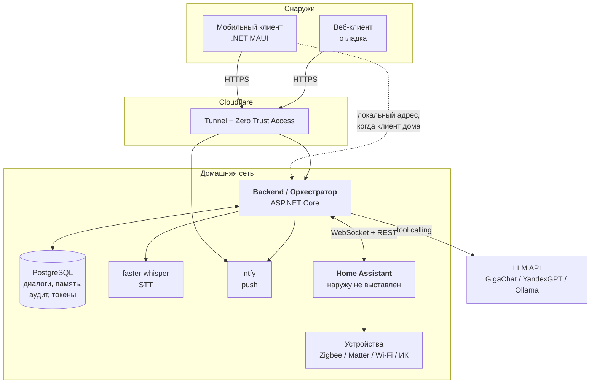

# Домовой

[](https://github.com/k-kuzmin/domovoy/actions/workflows/gitleaks.yml)
[](https://github.com/k-kuzmin/domovoy/actions/workflows/ci-fast.yml)
[](https://github.com/k-kuzmin/domovoy/actions/workflows/ci-heavy.yml)
[](LICENSE)

Персональный AI-агент для умного дома. Управление устройствами и ответы на
вопросы о состоянии дома на естественном языке, через Home Assistant, с
проактивными уведомлениями и собственным набором инструментов.

Отличие от штатных голосовых помощников — полный контроль над системным
промптом, набором инструментов и памятью; данные о доме не уходят третьим
лицам сверх необходимого.

> [!IMPORTANT]
> **В репозитории нет и не должно быть реальных данных.** Ни секретов, ни
> реальных `entity_id`, ни имён хостов, IP, MAC-адресов, ни топика ntfy, ни
> состава жильцов. Все примеры — вымышленная квартира и плейсхолдеры.
> Подробнее: [Секреты и приватные данные](#секреты-и-приватные-данные).

## Статус

<a href="https://github.com/k-kuzmin/domovoy/milestones">
<picture>
<source media="(prefers-color-scheme: dark)" srcset="https://raw.githubusercontent.com/k-kuzmin/domovoy/status/progress-dark.svg">

</picture>
</a>

Дорожная карта — в [milestones](https://github.com/k-kuzmin/domovoy/milestones),
разбивка работ — в [issues](https://github.com/k-kuzmin/domovoy/issues).

Приложение делается пятым, а не первым: промпт и набор инструментов будут
переписываться ежедневно первые недели — на сервере это `git push`, в
приложении пересборка и переустановка.

## Архитектура

Home Assistant не имеет публичного входа. Любой доступ снаружи — только через
Backend, по TLS, через Cloudflare Tunnel: исходящее соединение к edge, входящих
соединений к домашней сети нет, порты на роутере не открываются.



**Разделение ответственности**

| Слой | Отвечает за | Не отвечает за |
|---|---|---|
| Home Assistant | драйверы протоколов, состояния сущностей, детерминированные автоматизации | понимание естественного языка, память диалога |
| Backend | LLM-оркестрация, tool calling, память, профиль дома, проактивные правила, аутентификация | прямое общение с железом |
| Мобильный клиент | UI, запись аудио, приём push, отображение состояния | бизнес-логика, секреты, прямой доступ к HA |

Критичные для безопасности автоматизации — протечка перекрывает воду,
задымление включает сирену — живут на стороне Home Assistant, а не в правилах
Backend: они обязаны срабатывать при остановленном Backend и без интернета.

## Структура решения

```
src/
  Domovoy.Api            HTTP-слой, SSE, аутентификация устройств
  Domovoy.Core           оркестратор, tool-цикл, роутер, шаблоны ответов, порты
  Domovoy.Ha             клиент Home Assistant (REST + WebSocket), реестр сущностей
  Domovoy.Llm            адаптеры провайдеров (GigaChat, YandexGPT, Ollama)
  Domovoy.Voice          STT/TTS
  Domovoy.Notifications  правила проактивности, ntfy
  Domovoy.Data           EF Core, миграции
tests/
  Domovoy.Tests          модульные, архитектурные и smoke-тесты
```

Чистая архитектура, зависимости направлены внутрь. `Domovoy.Core` содержит
только порты и модели и **не ссылается ни на один другой проект решения** —
ни на транспорт, ни на БД, ни на провайдеров. Направление зависимостей
проверяется архитектурным тестом, а не соглашением.

## Стек

| Компонент | Решение |
|---|---|
| Backend | ASP.NET Core 8 (LTS), minimal API |
| Хранилище | PostgreSQL 16 + EF Core |
| LLM основной | GigaChat через OpenAI-совместимый слой |
| LLM резервный | YandexGPT |
| LLM перспектива | локальная модель через Ollama |
| STT | faster-whisper (ru) на сервере |
| TTS | Piper (ru), опционально |
| Push | ntfy, self-hosted |
| Мобильный клиент | .NET MAUI (Android приоритет) |
| Публикация наружу | Cloudflare Tunnel |
| Развёртывание | Docker Compose |

Провайдер LLM задаётся конфигурацией — `base_url`, `api_key`, `model`,
`dialect`. Провайдер-специфичных ветвлений вне слоя адаптера нет.

## Быстрый старт

Нужен только Docker. Запуск на примерах конфигурации, без реальных ключей:
незаполненный секрет — это состояние «не сконфигурировано», а не отказ старта.

```bash
git clone https://github.com/k-kuzmin/domovoy.git
cd domovoy

cp .env.example .env
cp config/entities.example.yaml       config/entities.yaml
cp config/home-profile.example.md     config/home-profile.md
cp config/proactive-rules.example.yaml config/proactive-rules.yaml
cp config/response-templates.example.yaml config/response-templates.yaml

docker compose up -d --build --wait
curl -s http://localhost:18080/health
```

Ожидаемый ответ — `{"status":"degraded"}`: без токена Home Assistant и ключа
провайдера LLM состояние деградированное, но сервис поднят. Анонимный
`/health` отдаёт только это одно поле; раздельный статус БД, Home Assistant и
LLM доступен на `GET /api/v1/health` под токеном устройства.

Скопированные файлы `config/` и `.env` закрыты `.gitignore` — заполнять их
реальными значениями безопасно. Пароль базы в `.env.example` — значение для
примера: наружу порт базы не публикуется, но при реальной эксплуатации
`POSTGRES_PASSWORD` меняется.

### Стек с Home Assistant

Home Assistant объявлен в том же `docker-compose.yml`, но под профилем `ha`:
обычный `docker compose up` его не поднимает и образ не тянет
([0027](docs/decisions/0027-home-assistant-compose-profile.md)). С профилем HA
встаёт в общую сеть стека, и Backend находит его по имени сервиса из
`HA_BASE_URL`. База живёт в отдельной сети `db` вместе с Backend — HA её не
видит.

```bash
docker compose --profile ha up -d --build --wait
docker compose --profile ha down
```

Чтобы HA поднимался всегда, без ключа, — раскомментировать в `.env` строку
`COMPOSE_PROFILES=ha`. Порт веб-интерфейса на хосте — `HA_HTTP_PORT`
(по умолчанию 8123).

**Первый запуск.** До первичной настройки страница создания владельца HA
открыта любому в локальной сети. Поэтому сразу после первого
`docker compose --profile ha up -d` пройти настройку с самой машины:
`http://localhost:8123` (или порт из `HA_HTTP_PORT`).

Веб-интерфейс опубликован на все интерфейсы хоста, чтобы открываться с
телефона в домашней сети. Наружу HA не выставляется (NFR-SEC-2): на роутере
под него нет ни проброса порта, ни UPnP-сопоставления, и это проверяется
вручную — с телефона на мобильном интернете страница открываться не должна.

Конфигурация HA — устройства, пользователи, токены — лежит в именованном томе
`homeassistant-config`, вне рабочего дерева. **`docker compose down -v` и
`docker volume prune` удаляют этот том**: HA после них настраивается заново.

## Резервное копирование и восстановление

Сценарии — в [`ops/backup/`](ops/backup/); подробности поведения и
предостережения — в их шапках.

**Что входит.** Каждую ночь в каталоге `domovoy-backup-<UTC-метка>`:

- `db.dump` — база Backend;
- `ha-config.tar.gz` — том конфигурации Home Assistant, снятый без его
  остановки;
- `manifest.txt` — числа для проверки восстановления, без `entity_id`.

**Место и объём** задаются в `.env`: `BACKUP_DIR` — существующий каталог на
внешнем носителе, например `<внешний-диск>/domovoy-backups`;
`BACKUP_MAX_SIZE_GB` — лимит суммарного объёма в ГБ, пусто — без лимита.
Хранятся 14 последних бэкапов. Неподключённый носитель и каталог внутри клона —
отказ, а не запись на системный диск.

**Расписание** — ежедневно в 03:30, задача `domovoy-backup` Планировщика
заданий Windows. Её ставит последним шагом установщик движка
`deploy/windows/engine-setup.ps1 -Install` (раздел «Автозапуск после
перезагрузки»), отдельного шага нет. Задача идёт без входа пользователя (тип
входа S4U, пароль не хранится):

```
wsl.exe -d domovoy-engine --cd <клон> --exec bash ops/backup/backup.sh
```

`backup.sh` выполняется внутри дистрибутива движка, где `docker` — сам
движок: ни интерактивной оболочки, ни обёртки задаче не нужно. `BACKUP_DIR`
задаётся путём Windows вида `D:/domovoy-backups` — внутри дистрибутива его
переводит `wslpath`. Правка `.env` переустановки не требует. Пропущенный
запуск (хост был выключен) Планировщик выполняет при первой возможности;
если dockerd в этот момент ещё поднимается, прогон откажет строкой в
`backup.log`, и следующий пойдёт в срок.

Бэкап вне расписания на хосте с движком в WSL — из каталога клона:
`wsl.exe -d domovoy-engine --exec bash ops/backup/backup.sh`. Там, где
движок — Docker Desktop или Linux, — `bash ops/backup/backup.sh`.
Состояние задачи (тип входа, последний результат) и хвост `backup.log`:

```powershell
powershell -ExecutionPolicy Bypass -File ops/backup/install-schedule.ps1 -Check
```

Откат на Docker Desktop, который живёт только в сессии вошедшего
пользователя, — `install-schedule.ps1 -LogonType Interactive`: задача
запускает `backup.sh` в Git Bash и стартует, только пока пользователь вошёл.

**Бэкап — секрет.** В нём токены Home Assistant, разметка дома, диалоги и
аудит: носитель хранится как ключ от дома и без шифрования в облако не
копируется.

**Проверка восстановления** — последний бэкап из `BACKUP_DIR` поднимается в
отдельном изолированном проекте compose, рабочий стек не трогается:

```bash
bash ops/backup/restore.sh --check
# хост с движком в WSL — из каталога клона:
wsl.exe -d domovoy-engine --exec bash ops/backup/restore.sh --check
```

**Полное восстановление после потери данных** —
`restore.sh --project <имя-проекта-из-.env> --from <каталог-бэкапа>`.
Порядок и предостережения (`down -v`, отказ рядом с работающим HA другого
проекта) — в шапке [`ops/backup/restore.sh`](ops/backup/restore.sh).

## Автозапуск после перезагрузки (Windows, WSL2)

Docker Desktop без входа пользователя не стартует, поэтому на хосте с
Windows 11 стек живёт в Docker Engine внутри своего WSL2-дистрибутива
`domovoy-engine`. Дистрибутив поднимает задача Планировщика при запуске
системы — без входа и без хранимого пароля. Почему так и что отвергнуто —
[0028](docs/decisions/0028-docker-engine-in-wsl.md). Сценарии — в
[`deploy/windows/`](deploy/windows/), подробности — в их шапках.

**Предусловия** — сценарий их не проверяет:

- в BIOS включено «восстановление после пропадания питания — включиться»
  (Restore on AC Power Loss: Power On);
- BitLocker без PIN до загрузки — иначе загрузка ждёт ввода;
- WSL2 установлен (`wsl --version`), клон лежит на локальном диске.

**Порты** — `API_HTTP_PORT` и `HA_HTTP_PORT` из `.env` (по умолчанию 18080 и
8123). Правило межсетевого экрана открывает их только для локальной подсети
и адресов петли хоста; на роутере проброса нет.

**Установка** — терминал PowerShell от администратора, в каталоге клона.
Повторный запуск ничего не дублирует. Дистрибутив при нём кратко
перезапускается (`wsl --terminate domovoy-engine`), и стек на эти секунды
недоступен; если держалка или дистрибутив работали до запуска, держалка сразу
после регистрации задач запускается снова, и контейнеры поднимаются сами
(`restart: unless-stopped`). Строка `keeper.resume` сухого прогона показывает,
будет ли это сделано:

```powershell
powershell -ExecutionPolicy Bypass -File deploy/windows/engine-setup.ps1 -Install -DryRun  # что будет сделано
powershell -ExecutionPolicy Bypass -File deploy/windows/engine-setup.ps1 -Install
```

`-Install` делает следующее:

1. создаёт дистрибутив из официального образа Ubuntu 24.04 и сверяет его
   SHA256 с `SHA256SUMS` того же сервера. Это проверка целостности загрузки,
   а не подлинности: подпись `SHA256SUMS` не проверяется, и образ,
   подменённый на сервере вместе с суммой, проверку пройдёт;
2. ставит внутрь Docker Engine под systemd;
3. регистрирует задачи `domovoy-engine` (держалка дистрибутива) и
   `domovoy-measure-boot` (замер);
4. пишет `networkingMode=mirrored` в `%USERPROFILE%\.wslconfig` — прежний
   файл сохраняется рядом как `.wslconfig.domovoy-backup`;
5. добавляет правило firewall;
6. ставит расписание бэкапа.

`wsl --shutdown` установка не выполняет: он гасит все дистрибутивы, в том
числе Docker Desktop.

**Окно переезда с Docker Desktop.** Данные переносят сценарии бэкапа и
восстановления; тома Docker Desktop не трогаются — это путь отката. История
рекордера HA за минуты окна теряется. Порядок:

1. На Docker Desktop: `docker compose stop api` — Backend больше не пишет в
   базу.
2. `bash ops/backup/backup.sh` из Git Bash.
3. `docker compose --profile ha stop` — именно `stop`, а не `down -v`.
4. `docker desktop stop`.
5. `wsl --shutdown` — применяет mirrored. Проверить, что остальные
   дистрибутивы и сервисы в WSL работают как прежде.
6. `Start-ScheduledTask domovoy-engine`.
7. Из каталога клона:
   `wsl.exe -d domovoy-engine --exec bash ops/backup/restore.sh --project domovoy --from /mnt/<диск>/<каталог-бэкапа>`
   (имя проекта — `COMPOSE_PROJECT_NAME` из `.env`).
8. Подъём стека: `docker compose --profile ha up -d --build --wait` (через функцию
   ниже). Проверить `/health` на `API_HTTP_PORT` с хоста, HA и `/health` с
   телефона в домашней сети.
9. Восстановление после ранней недоступности базы: `docker compose stop
   postgres` — `/health` отдаёт 503; `docker compose start postgres` — не
   позже чем через 60 с снова 200, без перезапуска api.
10. Проверка всех звеньев — код 0:

    ```powershell
    powershell -ExecutionPolicy Bypass -File deploy/windows/engine-setup.ps1 -Check
    ```

    `-Check` только читает: дистрибутив не запускает и не останавливает.
    Звенья внутри остановленного дистрибутива помечаются «не проверено», и
    код тогда ненулевой.
    Доступ из ЛВС `-Check` не проверяет — в mirrored хост не достаёт до
    дистрибутива по своему адресу в ЛВС; его проверяет `/health` с телефона
    в домашней сети (шаг 8), а звено печатается SKIP вне итога и кода.

**docker из Git Bash.** Движок живёт внутри дистрибутива, поэтому команды
`docker` из этого README идут через обёртку. Строка в `~/.bashrc`:

```bash
docker() { bash "<клон>/deploy/windows/docker-wsl.sh" "$@"; }
```

Обёртка выполняет `docker` внутри дистрибутива в текущем каталоге: каталог
Windows там виден как `/mnt/<диск>/…`, и относительные пути compose
(`./config`) движок находит. Пределы:

- абсолютные пути Windows в аргументах не переводятся;
- `-it` у `docker exec` зависит от TTY Git Bash;
- функция есть только в интерактивной оболочке, поэтому сценарии
  `ops/backup/*.sh` запускаются внутри дистрибутива (команды выше), а не
  через неё.

**Проверочные перезагрузки и замер.** Задача `domovoy-measure-boot` после
каждой загрузки дописывает строку в
`%LOCALAPPDATA%\domovoy-engine\measure-boot.log` пользователя, от
которого идёт держалка (S4U, обычные права — не SYSTEM: сценарий лежит в
клоне):

- старт ОС (событие Kernel-General 12) и `LastBootUpTime`;
- время POST (`FwPOSTTime`);
- первый ответ `/health` и первый ответ 200 формы стека — с секундами от
  старта ОС.

Засчитывается только ответ `{"status":"healthy"}` или `{"status":"degraded"}`;
иной ответ 200 помечается как чужой слушатель. Без ответа 200 за 30 минут
строка говорит «нет ответа 200».

Проверка — две перезагрузки подряд, между ними в систему не входить и
ничего не запускать:

1. «Перезагрузка» из меню Windows — не «Завершение работы»: при быстром
   запуске это гибридная загрузка, а не перезагрузка.
2. Снять и вернуть питание работающего ПК — он включается сам по настройке
   BIOS. Полное время от подачи питания до ответа засекается по часам с
   секундами и сверяется со строкой замера: `FwPOSTTime` плюс секунды от
   старта ОС до 200.

После каждой — `GET http://<адрес-хоста>:<API_HTTP_PORT>/health` с
телефона в домашней сети, затем вход и `engine-setup.ps1 -Check`. Адрес
хоста в issue не переносится.

**Откат на Docker Desktop:**

1. Терминал PowerShell от администратора, в каталоге клона:

   ```powershell
   powershell -ExecutionPolicy Bypass -File deploy/windows/engine-setup.ps1 -Uninstall -DryRun  # что будет сделано
   powershell -ExecutionPolicy Bypass -File deploy/windows/engine-setup.ps1 -Uninstall
   ```

   `-Uninstall` останавливает стек внутри движка (`stop`, тома целы), снимает
   задачи `domovoy-engine` и `domovoy-measure-boot` — иначе после
   перезагрузки рядом с Docker Desktop поднялся бы второй стек, — ставит
   расписание бэкапа под Docker Desktop (`-LogonType Interactive`), гасит
   дистрибутив, удаляет правило firewall и возвращает `.wslconfig` из копии
   или удаляет его по отметке. Дистрибутив с томами остаётся:
   `wsl --unregister domovoy-engine` уничтожает их — только решением
   владельца.
2. Убрать функцию `docker()` из `~/.bashrc` и открыть новую оболочку —
   иначе `docker` уйдёт в движок WSL.
3. `wsl --shutdown`, `docker desktop start`,
   `docker compose --profile ha start`.

Удаление Docker Desktop и его томов — после приёмки и только решением
владельца.

## Локальная разработка

Проекты собираются под `net8.0`. SDK 9 подходит: целевой пакет `net8.0`
подтягивается из NuGet, нужен установленный рантайм 8.0.

```bash
# Git-хуки: без этой команды pre-commit не работает —
# файлы в .githooks не подключаются к клону сами
git config core.hooksPath .githooks

dotnet restore
dotnet build
dotnet test
dotnet run --project src/Domovoy.Api
```

Ещё два инструмента нужны, если задачу ведёт агент в Claude CLI. Обычной
разработке руками они не нужны.

- **python 3** — на нём работает впрыск правил (`.claude/hooks/rule-injector.*`):
  хук напоминает правило в момент действия. Без python хук пропускает вызов, а
  не отказывает — напоминание не граница, и работа без него не встаёт.
- **`jq`** — его читают `scripts/plan.sh` (проверка и рендер плана),
  `scripts/review-comments.sh` (построчные замечания ревью), `scripts/risk.sh`
  (уровень риска) и `scripts/council.sh` (сводка совета).

Как устроен конвейер работы с агентом — [`docs/pipeline.md`](docs/pipeline.md).

Секреты локально — только через `dotnet user-secrets`, они лежат в профиле
пользователя вне дерева проекта:

```bash
cd src/Domovoy.Api
dotnet user-secrets set "Ha:Token"        "<токен Home Assistant>"
dotnet user-secrets set "Llm:ApiKey"      "<ключ провайдера>"
dotnet user-secrets set "Ntfy:Topic"      "<имя топика>"
dotnet user-secrets list
```

### Команды

| Задача | Команда |
|---|---|
| Сборка | `dotnet build` |
| Тесты | `dotnet test` |
| Запуск API | `dotnet run --project src/Domovoy.Api` |
| Формат и стиль | `dotnet format --verify-no-changes` |
| Миграции: создать | `dotnet ef migrations add <Имя> --project src/Domovoy.Data --startup-project src/Domovoy.Api` |
| Миграции: применить | `dotnet ef database update --project src/Domovoy.Data --startup-project src/Domovoy.Api` |
| Поиск секретов: индекс | `gitleaks git --staged --redact --no-banner` |
| Поиск секретов: история | `gitleaks git --redact --no-banner` |
| Стек целиком | `docker compose up -d --build --wait` |
| Стек с Home Assistant | `docker compose --profile ha up -d --build --wait` |
| Остановить стек с Home Assistant | `docker compose --profile ha down` |
| Движок в WSL: проверка автозапуска | `powershell -ExecutionPolicy Bypass -File deploy/windows/engine-setup.ps1 -Check` |
| Движок в WSL: откат на Docker Desktop | `powershell -ExecutionPolicy Bypass -File deploy/windows/engine-setup.ps1 -Uninstall` (администратор) |
| Тесты сценариев движка | `bash deploy/windows/engine-setup.test.sh` |
| Состояние расписания бэкапа | `powershell -ExecutionPolicy Bypass -File ops/backup/install-schedule.ps1 -Check` |
| Бэкап вне расписания | `bash ops/backup/backup.sh`; движок в WSL — `wsl.exe -d domovoy-engine --exec bash ops/backup/backup.sh` |
| Проверка восстановления | `bash ops/backup/restore.sh --check` |
| Тесты бэкапа (нужен docker) | `bash ops/backup/backup.test.sh` |

## API

Базовый префикс `/api/v1`, аутентификация — Bearer-токен устройства.
На этапе каркаса любой запрос к `/api/v1`, кроме `POST /auth/device`,
получает `401`: привязка устройств ещё не реализована, и предъявленный токен
отклоняется. `POST /auth/device` анонимный и отвечает `501`.

| Метод | Путь | Назначение |
|---|---|---|
| `POST` | `/auth/device` | регистрация устройства, обмен кода привязки на токен |
| `POST` | `/chat` | текстовый запрос, ответ потоком SSE |
| `POST` | `/voice` | multipart с аудио, первое событие потока — `recognized` |
| `POST` | `/confirm` | подтверждение чувствительного действия |
| `GET` | `/state` | срез состояния дома для экрана «Дом» |
| `POST` | `/action` | быстрое действие из UI, минуя LLM |
| `GET` | `/notifications` | лента уведомлений |
| `GET` | `/health` | раздельный статус БД, Home Assistant и LLM |

Формат ошибок единый: `{ "error": { "code": "...", "message": "...", "details": ... } }`.

`GET /health` без префикса и без токена отдаёт только пригодность к работе —
для healthcheck контейнера и туннеля. Подробный статус компонентов доступен
на `GET /api/v1/health` под Bearer-токеном: публичный домен индексируется и
сканируется, состав компонентов наружу не отдаётся.

## Секреты и приватные данные

Секретов и приватных данных нет в файлах проекта **ни в одной копии** — ни в
публичной, ни в локальной. Веток «чистая» и «рабочая» не существует. Значения
приходят из источников конфигурации .NET, код читает `IConfiguration` и не
знает происхождения значения.

| Среда | Источник |
|---|---|
| Локальная разработка | `dotnet user-secrets` |
| Продакшен | переменные окружения через `env_file` в Docker Compose |

**Приватное — не только ключи.** Реестр сущностей и профиль дома вместе дают
планировку, состав жильцов, расписание отсутствия и расположение датчиков.
Это чувствительнее токенов. Не попадают в репозиторий:

- реальные `entity_id`, особенно содержащие имена людей
- профиль дома: комнаты, жильцы, распорядок
- имена хостов и поддоменов, локальные IP, MAC-адреса
- **имя топика ntfy** — функционально это пароль: знающий его читает
  уведомления и отправляет свои
- правила проактивности с реальными привязками
- дампы БД, бэкапы Home Assistant, логи

**Два рубежа защиты.** Основной — `gitleaks` в pre-commit хуке: блокирует
коммит до попадания данных в историю. Дублирующий — `gitleaks` в CI на каждый
push и PR, на случай коммита в обход хуков. Помимо стандартных правил
провайдеров закрыты токен Home Assistant, ключи GigaChat и Yandex Cloud,
топик ntfy, приватные IPv4, MAC-адреса и реальные имена хостов. В настройках
репозитория включены secret scanning и push protection.

Репозиторий публичный с первого коммита. Схема «сначала приватно, потом
почистить и открыть» не применяется: перезапись истории не удаляет данные из
форков, кэша хостинга и чужих клонов. Секрет, однажды попавший в коммит,
считается скомпрометированным и подлежит **отзыву**, а не удалению.

## Решения

Решения, расходящиеся с ТЗ или не выводимые из него, записаны в
[`docs/decisions/`](docs/decisions/README.md). Причина простая: через
месяц по коду не отличить принятое решение от недосмотра.

Наиболее заметные: в репозитории только плейсхолдеры вместо реальных
хостов, `/health` разделён на анонимный и защищённый, валидация
конфигурации на старте проверяет форму, а не наличие секретов.

## Лицензия

[MIT](LICENSE)
