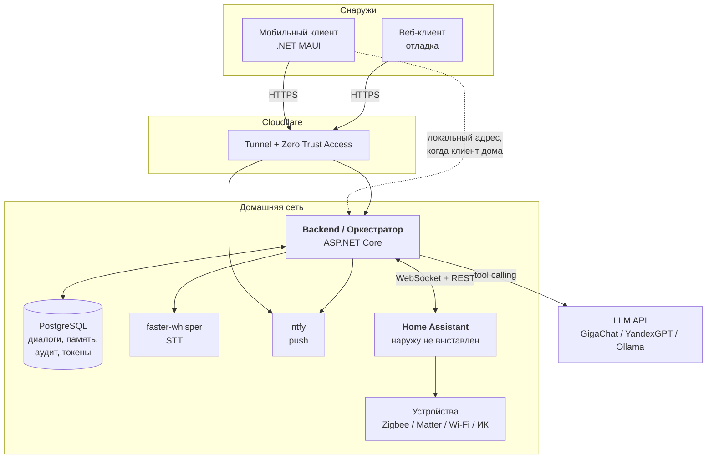

# Домовой

[](https://github.com/k-kuzmin/domovoy/actions/workflows/gitleaks.yml)
[](https://github.com/k-kuzmin/domovoy/actions/workflows/ci-fast.yml)
[](https://github.com/k-kuzmin/domovoy/actions/workflows/ci-heavy.yml)
[](LICENSE)

Персональный AI-агент для умного дома. Управление устройствами и ответы на
вопросы о состоянии дома на естественном языке, через Home Assistant, с
проактивными уведомлениями и собственным набором инструментов.

Отличие от штатных голосовых помощников — полный контроль над системным
промптом, набором инструментов и памятью; данные о доме не уходят третьим
лицам сверх необходимого.

> [!IMPORTANT]
> **В репозитории нет и не должно быть реальных данных.** Ни секретов, ни
> реальных `entity_id`, ни имён хостов, IP, MAC-адресов, ни топика ntfy, ни
> состава жильцов. Все примеры — вымышленная квартира и плейсхолдеры.
> Подробнее: [Секреты и приватные данные](#секреты-и-приватные-данные).

## Статус

<a href="https://github.com/k-kuzmin/domovoy/milestones">
<picture>
<source media="(prefers-color-scheme: dark)" srcset="https://raw.githubusercontent.com/k-kuzmin/domovoy/status/progress-dark.svg">

</picture>
</a>

Дорожная карта — в [milestones](https://github.com/k-kuzmin/domovoy/milestones),
разбивка работ — в [issues](https://github.com/k-kuzmin/domovoy/issues).

Приложение делается пятым, а не первым: промпт и набор инструментов будут
переписываться ежедневно первые недели — на сервере это `git push`, в
приложении пересборка и переустановка.

## Архитектура

Home Assistant не имеет публичного входа. Любой доступ снаружи — только через
Backend, по TLS, через Cloudflare Tunnel: исходящее соединение к edge, входящих
соединений к домашней сети нет, порты на роутере не открываются.



**Разделение ответственности**

| Слой | Отвечает за | Не отвечает за |
|---|---|---|
| Home Assistant | драйверы протоколов, состояния сущностей, детерминированные автоматизации | понимание естественного языка, память диалога |
| Backend | LLM-оркестрация, tool calling, память, профиль дома, проактивные правила, аутентификация | прямое общение с железом |
| Мобильный клиент | UI, запись аудио, приём push, отображение состояния | бизнес-логика, секреты, прямой доступ к HA |

Критичные для безопасности автоматизации — протечка перекрывает воду,
задымление включает сирену — живут на стороне Home Assistant, а не в правилах
Backend: они обязаны срабатывать при остановленном Backend и без интернета.

## Структура решения

```
src/
  Domovoy.Api            HTTP-слой, SSE, аутентификация устройств
  Domovoy.Core           оркестратор, tool-цикл, роутер, шаблоны ответов, порты
  Domovoy.Ha             клиент Home Assistant (REST + WebSocket), реестр сущностей
  Domovoy.Llm            адаптеры провайдеров (GigaChat, YandexGPT, Ollama)
  Domovoy.Voice          STT/TTS
  Domovoy.Notifications  правила проактивности, ntfy
  Domovoy.Data           EF Core, миграции
tests/
  Domovoy.Tests          модульные, архитектурные и smoke-тесты
```

Чистая архитектура, зависимости направлены внутрь. `Domovoy.Core` содержит
только порты и модели и **не ссылается ни на один другой проект решения** —
ни на транспорт, ни на БД, ни на провайдеров. Направление зависимостей
проверяется архитектурным тестом, а не соглашением.

## Стек

| Компонент | Решение |
|---|---|
| Backend | ASP.NET Core 8 (LTS), minimal API |
| Хранилище | PostgreSQL 16 + EF Core |
| LLM основной | GigaChat через OpenAI-совместимый слой |
| LLM резервный | YandexGPT |
| LLM перспектива | локальная модель через Ollama |
| STT | faster-whisper (ru) на сервере |
| TTS | Piper (ru), опционально |
| Push | ntfy, self-hosted |
| Мобильный клиент | .NET MAUI (Android приоритет) |
| Публикация наружу | Cloudflare Tunnel |
| Развёртывание | Docker Compose |

Провайдер LLM задаётся конфигурацией — `base_url`, `api_key`, `model`,
`dialect`. Провайдер-специфичных ветвлений вне слоя адаптера нет.

## Быстрый старт

Нужен только Docker. Запуск на примерах конфигурации, без реальных ключей:
незаполненный секрет — это состояние «не сконфигурировано», а не отказ старта.

```bash
git clone https://github.com/k-kuzmin/domovoy.git
cd domovoy

cp .env.example .env
cp config/entities.example.yaml       config/entities.yaml
cp config/home-profile.example.md     config/home-profile.md
cp config/proactive-rules.example.yaml config/proactive-rules.yaml
cp config/response-templates.example.yaml config/response-templates.yaml

docker compose up -d --build
curl -s http://localhost:8080/health
```

Ожидаемый ответ — `{"status":"degraded"}`: без токена Home Assistant и ключа
провайдера LLM состояние деградированное, но сервис поднят. Анонимный
`/health` отдаёт только это одно поле; раздельный статус БД, Home Assistant и
LLM доступен на `GET /api/v1/health` под токеном устройства.

Скопированные `config/*.yaml` и `.env` закрыты `.gitignore` — заполнять их
реальными значениями безопасно. Пароль базы в `.env.example` — значение для
примера: наружу порт базы не публикуется, но при реальной эксплуатации
`POSTGRES_PASSWORD` меняется.

### Стек с Home Assistant

Home Assistant объявлен в том же `docker-compose.yml`, но под профилем `ha`:
обычный `docker compose up` его не поднимает и образ не тянет
([0027](docs/decisions/0027-home-assistant-compose-profile.md)). С профилем HA
встаёт в общую сеть стека, и Backend находит его по имени сервиса из
`HA_BASE_URL`. База живёт в отдельной сети `db` вместе с Backend — HA её не
видит.

```bash
docker compose --profile ha up -d --build
docker compose --profile ha down
```

Чтобы HA поднимался всегда, без ключа, — раскомментировать в `.env` строку
`COMPOSE_PROFILES=ha`. Порт веб-интерфейса на хосте — `HA_HTTP_PORT`
(по умолчанию 8123).

**Первый запуск.** До первичной настройки страница создания владельца HA
открыта любому в локальной сети. Поэтому сразу после первого
`docker compose --profile ha up -d` пройти настройку с самой машины:
`http://localhost:8123` (или порт из `HA_HTTP_PORT`).

Веб-интерфейс опубликован на все интерфейсы хоста, чтобы открываться с
телефона в домашней сети. Наружу HA не выставляется (NFR-SEC-2): на роутере
под него нет ни проброса порта, ни UPnP-сопоставления, и это проверяется
вручную — с телефона на мобильном интернете страница открываться не должна.

Конфигурация HA — устройства, пользователи, токены — лежит в именованном томе
`homeassistant-config`, вне рабочего дерева. **`docker compose down -v` и
`docker volume prune` удаляют этот том**: HA после них настраивается заново.

## Резервное копирование и восстановление

Сценарии — в [`ops/backup/`](ops/backup/), запускаются на хосте из Git Bash.
Новых образов и библиотек нет: всё делается через `docker compose exec` в
уже работающих контейнерах.

**Что входит в бэкап.** Каталог `domovoy-backup-<UTC-метка>` содержит:

- `db.dump` — база Backend, `pg_dump -Fc` изнутри контейнера `postgres`;
- `ha-config.tar.gz` — том `homeassistant-config` целиком. HA не
  останавливается: базы sqlite (рекордер, `zigbee.db`) кладутся онлайн-копией
  через backup API sqlite, их `-wal`/`-shm` в архив не идут;
- `manifest.txt` — число строк по таблицам базы и число не отключённых
  сущностей реестра HA. Только числа, без `entity_id`.

Перед тем как каталог получит окончательное имя, дамп читается целиком
(`pg_restore`), а архив проверяется `gzip -t` и `tar -t`. Пока проверка не
пройдена, каталог называется `….partial`, а при провале удаляется.

**Место.** Внешний диск, подключённый к хосту, например
`<внешний-диск>\domovoy-backups`. Каталог создаётся один раз руками. Если его
нет (диск не подключён), сценарий отказывает и на системный диск не пишет.
Каталог внутри клона он тоже отвергает. Лог прогонов —
`<внешний-диск>\domovoy-backups\backup.log`. Хранятся 14 последних бэкапов, число
задаёт `--keep N`. Ротация трогает только полные каталоги `domovoy-backup-*`.

```bash
bash ops/backup/backup.sh "<внешний-диск>/domovoy-backups"
```

**Бэкап — секрет.** В томе HA лежат токены (`.storage/auth`) и вся разметка
дома, в базе — диалоги и аудит. Носитель хранится как ключ от дома: в облако
без шифрования его не копировать, в репозиторий бэкап не попадает по
построению.

**Расписание.** Ежедневно в 03:30, Планировщиком заданий Windows. Docker
Desktop работает в сессии пользователя, поэтому задача запускается только
при его входе (`/IT`). Пока автозапуск стека после перезагрузки (#6) не
закрыт, в 03:30 Docker может быть не запущен. Тогда бэкап отказывает с
ненулевым кодом и строкой в `backup.log`, а в задаче виден `Last Result`.

```bat
schtasks /Create /TN domovoy-backup /SC DAILY /ST 03:30 /IT ^
  /TR "\"<путь-к-bash.exe>\" \"<путь-к-клону>/ops/backup/backup.sh\" \"<внешний-диск>/domovoy-backups\""
schtasks /Query /TN domovoy-backup /V /FO LIST
```

`<путь-к-bash.exe>` — `bash.exe` из Git for Windows (каталог `bin` установки).

**Проверка восстановления** — без простоя рабочего стека:

```bash
bash ops/backup/restore.sh --check --from "<внешний-диск>/domovoy-backups/domovoy-backup-<метка>"
```

Бэкап поднимается в отдельном проекте compose `domovoy-restore-check` с
пустыми томами. Используются только `docker-compose.yml` и
`ops/backup/restore-check.compose.yml`: `docker-compose.override.yml` с
USB-координатором не подхватывается. Сети проекта — `internal`, порты на хост
не публикуются. Восстановленный HA не видит ни ЛВС, ни интернета и не
управляет устройствами параллельно с рабочим, поэтому устройства в нём
`unavailable`. Проверки:

- `БД: таблицы совпадают с манифестом` — число строк в каждой таблице;
- `HA: N из N сущностей реестра в состояниях` — каждая не отключённая
  сущность из бэкапа есть в `/api/states` восстановленного HA. Запрос идёт
  изнутри контейнера `api` с токеном из его окружения;
- `/health отвечает` — восстановленный Backend поднялся. Статус печатается
  как есть: LLM и ntfy в изолированной сети недоступны.

В конце печатается `восстановление и проверки: M мин S с`, и проверочный
проект удаляется вместе с томами при любом исходе.

**Полное восстановление после потери данных** — в проект с именем из `.env`
(`COMPOSE_PROJECT_NAME`). Тогда ночной бэкап и все команды `docker compose`
без `-p` продолжают работать с восстановленным стеком. Восстановление идёт
только в пустой проект — ни контейнеров, ни томов, — поэтому сломанный
проект сначала удаляется. **`down -v` уничтожает остатки томов**: выполнять
его, только когда данные уже потеряны и бэкап для восстановления выбран.

```bash
docker compose --profile ha down -v
bash ops/backup/restore.sh --project <имя-проекта-из-.env> \
  --from "<внешний-диск>/domovoy-backups/domovoy-backup-<метка>"
```

Режим использует обычные файлы compose, включая `docker-compose.override.yml`
с USB-координатором, обычные сети и порты из `.env`. Поэтому восстановленный
HA рядом с работающим управлял бы теми же устройствами параллельно с ним:
рядом с работающим стеком безопасен только `--check`. Перед восстановлением
в любой другой проект рабочий стек останавливается — без `-v`, тома
остаются:

```bash
docker compose --profile ha down
```

`restore.sh --project` отказывает, пока на хосте работает `homeassistant`
другого проекта compose, и называет этот проект. В проект, где есть
контейнеры или тома, восстановление не идёт: перезаписи данных нет. Если
восстановление отменяется или повторяется, проект сначала удаляется, иначе
следующий запуск откажет:

```bash
docker compose -p <имя-проекта> --profile ha down -v
```

Файлы клона (`.env`, `config/*`) в бэкап не входят: проверка идёт на том же
хосте, и клон её переживает. Потерю хоста целиком этот бэкап не закрывает.

## Локальная разработка

Проекты собираются под `net8.0`. SDK 9 подходит: целевой пакет `net8.0`
подтягивается из NuGet, нужен установленный рантайм 8.0.

```bash
# Git-хуки: без этой команды pre-commit не работает —
# файлы в .githooks не подключаются к клону сами
git config core.hooksPath .githooks

dotnet restore
dotnet build
dotnet test
dotnet run --project src/Domovoy.Api
```

Ещё два инструмента нужны, если задачу ведёт агент в Claude CLI. Обычной
разработке руками они не нужны.

- **python 3** — на нём работает впрыск правил (`.claude/hooks/rule-injector.*`):
  хук напоминает правило в момент действия. Без python хук пропускает вызов, а
  не отказывает — напоминание не граница, и работа без него не встаёт.
- **`jq`** — его читают `scripts/plan.sh` (проверка и рендер плана),
  `scripts/review-comments.sh` (построчные замечания ревью), `scripts/risk.sh`
  (уровень риска) и `scripts/council.sh` (сводка совета).

Как устроен конвейер работы с агентом — [`docs/pipeline.md`](docs/pipeline.md).

Секреты локально — только через `dotnet user-secrets`, они лежат в профиле
пользователя вне дерева проекта:

```bash
cd src/Domovoy.Api
dotnet user-secrets set "Ha:Token"        "<токен Home Assistant>"
dotnet user-secrets set "Llm:ApiKey"      "<ключ провайдера>"
dotnet user-secrets set "Ntfy:Topic"      "<имя топика>"
dotnet user-secrets list
```

### Команды

| Задача | Команда |
|---|---|
| Сборка | `dotnet build` |
| Тесты | `dotnet test` |
| Запуск API | `dotnet run --project src/Domovoy.Api` |
| Формат и стиль | `dotnet format --verify-no-changes` |
| Миграции: создать | `dotnet ef migrations add <Имя> --project src/Domovoy.Data --startup-project src/Domovoy.Api` |
| Миграции: применить | `dotnet ef database update --project src/Domovoy.Data --startup-project src/Domovoy.Api` |
| Поиск секретов: индекс | `gitleaks git --staged --redact --no-banner` |
| Поиск секретов: история | `gitleaks git --redact --no-banner` |
| Стек целиком | `docker compose up -d --build` |
| Стек с Home Assistant | `docker compose --profile ha up -d --build` |
| Остановить стек с Home Assistant | `docker compose --profile ha down` |
| Бэкап БД и тома HA | `bash ops/backup/backup.sh "<внешний-диск>/domovoy-backups"` |
| Проверка восстановления | `bash ops/backup/restore.sh --check --from "<каталог-бэкапа>"` |
| Тесты бэкапа (нужен docker) | `bash ops/backup/backup.test.sh` |

## API

Базовый префикс `/api/v1`, аутентификация — Bearer-токен устройства.
На этапе каркаса все эндпоинты, кроме `/health`, отвечают `501`.

| Метод | Путь | Назначение |
|---|---|---|
| `POST` | `/auth/device` | регистрация устройства, обмен кода привязки на токен |
| `POST` | `/chat` | текстовый запрос, ответ потоком SSE |
| `POST` | `/voice` | multipart с аудио, первое событие потока — `recognized` |
| `POST` | `/confirm` | подтверждение чувствительного действия |
| `GET` | `/state` | срез состояния дома для экрана «Дом» |
| `POST` | `/action` | быстрое действие из UI, минуя LLM |
| `GET` | `/notifications` | лента уведомлений |
| `GET` | `/health` | раздельный статус БД, Home Assistant и LLM |

Формат ошибок единый: `{ "error": { "code": "...", "message": "...", "details": ... } }`.

`GET /health` без префикса и без токена отдаёт только пригодность к работе —
для healthcheck контейнера и туннеля. Подробный статус компонентов доступен
на `GET /api/v1/health` под Bearer-токеном: публичный домен индексируется и
сканируется, состав компонентов наружу не отдаётся.

## Секреты и приватные данные

Секретов и приватных данных нет в файлах проекта **ни в одной копии** — ни в
публичной, ни в локальной. Веток «чистая» и «рабочая» не существует. Значения
приходят из источников конфигурации .NET, код читает `IConfiguration` и не
знает происхождения значения.

| Среда | Источник |
|---|---|
| Локальная разработка | `dotnet user-secrets` |
| Продакшен | переменные окружения через `env_file` в Docker Compose |

**Приватное — не только ключи.** Реестр сущностей и профиль дома вместе дают
планировку, состав жильцов, расписание отсутствия и расположение датчиков.
Это чувствительнее токенов. Не попадают в репозиторий:

- реальные `entity_id`, особенно содержащие имена людей
- профиль дома: комнаты, жильцы, распорядок
- имена хостов и поддоменов, локальные IP, MAC-адреса
- **имя топика ntfy** — функционально это пароль: знающий его читает
  уведомления и отправляет свои
- правила проактивности с реальными привязками
- дампы БД, бэкапы Home Assistant, логи

**Два рубежа защиты.** Основной — `gitleaks` в pre-commit хуке: блокирует
коммит до попадания данных в историю. Дублирующий — `gitleaks` в CI на каждый
push и PR, на случай коммита в обход хуков. Помимо стандартных правил
провайдеров закрыты токен Home Assistant, ключи GigaChat и Yandex Cloud,
топик ntfy, приватные IPv4, MAC-адреса и реальные имена хостов. В настройках
репозитория включены secret scanning и push protection.

Репозиторий публичный с первого коммита. Схема «сначала приватно, потом
почистить и открыть» не применяется: перезапись истории не удаляет данные из
форков, кэша хостинга и чужих клонов. Секрет, однажды попавший в коммит,
считается скомпрометированным и подлежит **отзыву**, а не удалению.

## Решения

Решения, расходящиеся с ТЗ или не выводимые из него, записаны в
[`docs/decisions/`](docs/decisions/README.md). Причина простая: через
месяц по коду не отличить принятое решение от недосмотра.

Наиболее заметные: в репозитории только плейсхолдеры вместо реальных
хостов, `/health` разделён на анонимный и защищённый, валидация
конфигурации на старте проверяет форму, а не наличие секретов.

## Лицензия

[MIT](LICENSE)
